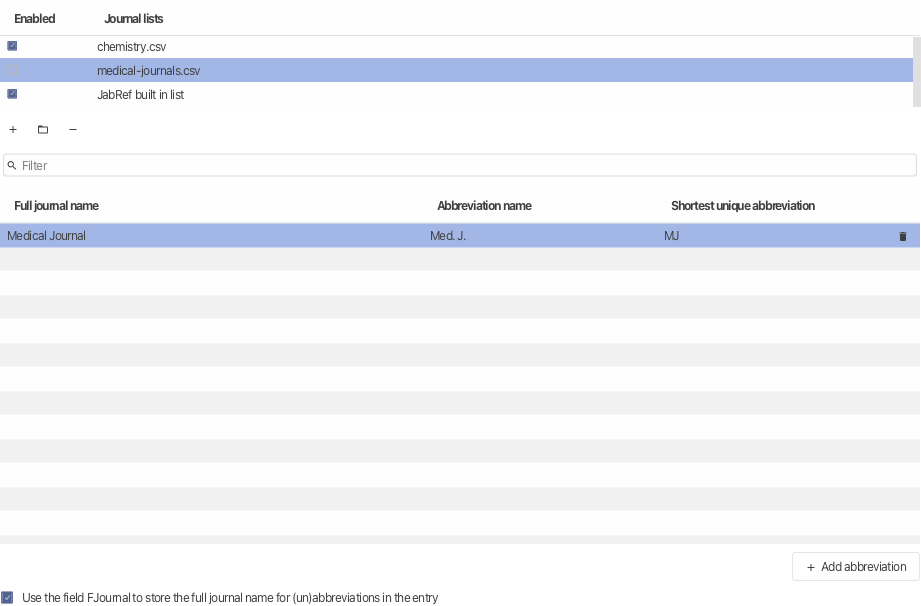
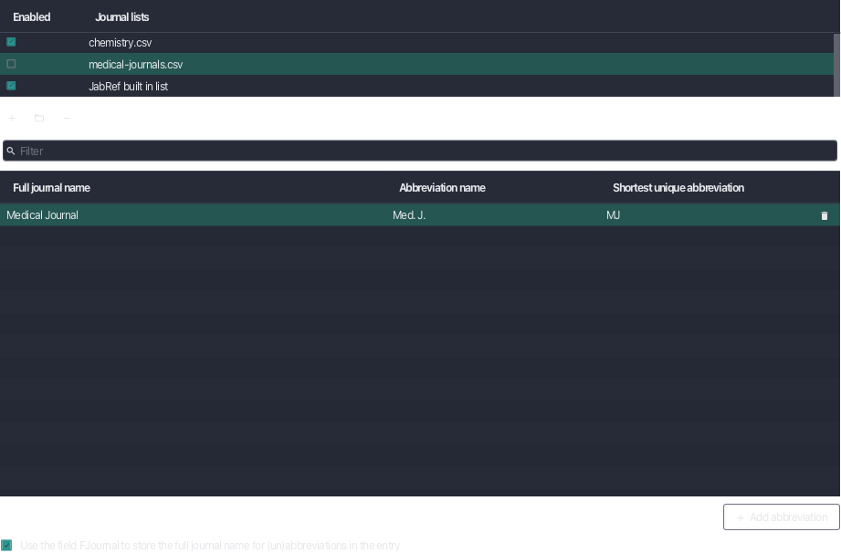

# Journal Abbreviations

## Preparation

- Ensure that `buildres/abbrv.jabref.org` contains data. Otherwise, the submodules were not configured correctly.
- Ensure that `build/resources/main/journals/journal-list.mv` exists. It is generated by gradle task `generateJournalListMV`, which uses `org.jabref.cli.JournalListMvGenerator`.

## Where does the data come from?

The generator uses all `.csv` files from <https://github.com/JabRef/abbrv.jabref.org/tree/main/journals>, but ignores following ones:

```java
        Set<String> ignoredNames = Set.of(
                // remove all lists without dot in them:
                // we use abbreviation lists containing dots in them only (to be consistent)
                "journal_abbreviations_entrez.csv",
                "journal_abbreviations_medicus.csv",
                "journal_abbreviations_webofscience-dotless.csv",

                // we currently do not have good support for BibTeX strings
                "journal_abbreviations_ieee_strings.csv"
        );
```

## Loading and refreshing journal lists

`AbbreviationPreferences.shouldUseBuiltInJournalList()` defaults to `true`.
When disabled, repository loading skips the built-in aggregate but still loads external CSV lists and LTWA.
`loadBuiltInRepository()` always loads the built-in aggregate, including for the preferences list display.
Bundled LTWA data is loaded lazily once per JVM and shared across repositories and reloads.
Its private prefix and suffix trees are populated only during construction; each lookup uses its own parser and listener state.
Initialization is synchronized, and failed loads can be retried rather than caching an empty fallback.
Journal-list contents remain separate for each repository.
See [Share bundled LTWA data](../decisions/0082-share-bundled-ltwa-data.md) for the lifecycle decision.

External list paths retain their order in `AbbreviationPreferences.getExternalJournalLists()`.
`getDisabledExternalJournalLists()` stores disabled paths separately; the loader skips them without changing the precedence of enabled lists.
The preferences table keeps disabled lists selectable and editable, and applies checkbox changes only on Save.
Built-in abbreviation row models are constructed in the background before they are attached to the preferences table.
External list paths are compared as normalized absolute paths, so opening a list again cannot add a duplicate row.
Duplicate saved paths are loaded once; saving also deduplicates paths while retaining the first row's contents and enabled state.

The GUI retains its injected repository when saving preferences and calls `reload` with the saved values.
Reloading captures the preference values before scheduling background work, then publishes the completed data in one update.
The snapshot includes disabled external paths, so later preference edits cannot change a scheduled reload.
Each request has a generation number: a result from an older request cannot overwrite a newer request.
Starting a new reload cancels the previous background task.
Canceled queued requests skip loading; repository construction and CSV writes share a background I/O lock.
A library read that cannot stop immediately cannot overlap another reload or a CSV rewrite by the same repository.
Success/failure callbacks and repository publication run after releasing this lock.
The FX thread never waits on the I/O lock.
Existing consumers see the refreshed data on their next lookup; while loading, they continue using the previous data.

## Preferences table

Each list has an enabled checkbox, while selecting its row displays its abbreviations for inspection or editing.
These cropped previews show the preferences tab with temporary example lists.





## Future work

See <https://github.com/JabRef/jabref-issue-melting-pot/issues/41>
