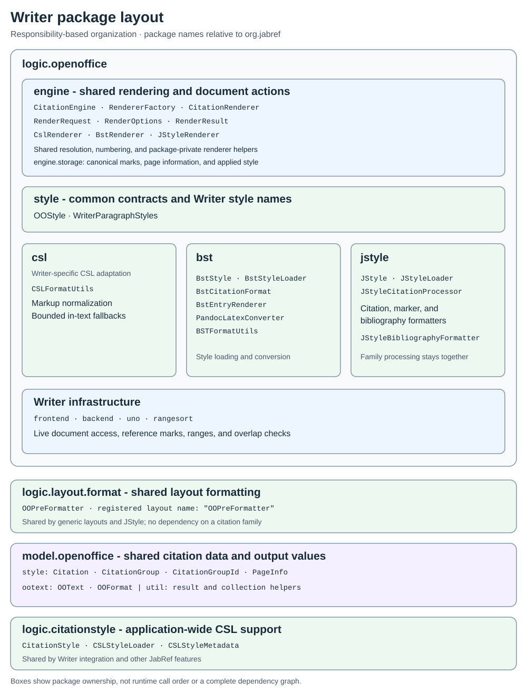

# Package layout and ownership

The Writer integration separates GUI actions, citation rendering, persistent citation state, and low-level UNO access.
Use this guide to locate the code responsible for a change; the [architecture overview](overview.md), [ADR-0084](../../decisions/0084-canonical-writer-citations.md), and [requirements](../../requirements/openoffice.md) define the behavior and compatibility contract.

## Source roots and package boundaries

GUI code lives under `jabgui/src/main/java/org/jabref/gui/openoffice/`.
The logic and model packages below live under `jablib/src/main/java/org/jabref/`.

| Package | Responsibility | Principal types |
| --- | --- | --- |
| `gui.openoffice` in `jabgui` | Present document actions, select styles, and show results. | `OpenOfficePanel`, `OpenOfficeCitationController`, `OpenOfficeDocumentConnection`, `CslStyleResolver` |
| `logic.openoffice` | Shared citation identities, preferences, and Zotero protocol support. | `CitationIds`, `CitedEntryCollector`, `OpenOfficePreferences`, `ZoteroReferenceMark`, `ZoteroCitationLinker`, `ZoteroDocumentPreferences` |
| `logic.openoffice.engine` | Coordinate document actions and compute renderer output. | `CitationEngine`, `UpdatePipeline`, `CitationGroupEditor`, `CitationFormatConverter`, `DocumentWriteSession`, `CitationRenderer` |
| `logic.openoffice.engine.storage` | Read canonical citations and apply prepared text/property changes. | `MarkStore`, `CitationMarkerWriter`, `DocumentStyleStore`, `UndoableDocumentProperties` |
| `logic.openoffice.frontend` | Combine the live document with the citation model, ordering, and overlap protection. | `DocumentCitations`, `DocumentOrder`, `RangeForOverlapCheck` |
| `logic.openoffice.backend` | Work with concrete Writer reference-mark ranges without interpreting citation names. | `WriterReferenceMark`, `WriterReferenceMarks`, `ReferenceMarkTextWriter`, `WriterTextContext` |
| `logic.openoffice.uno` | Access Writer services, interfaces, cursors, named content, and properties. | `UnoInterfaces`, `NamedTextContentInserter`, `NamedTextContentPlacement`, `NamedTextContentLookup`, `OOTextWriter` |
| `logic.openoffice.rangesort` | Order UNO ranges and detect overlaps. | `RangeSort`, `RangeSortVisual`, `RestorableTextViewCursor`, `WithinSetRangeOverlapFinder`, `BetweenSetsRangeOverlapFinder` |
| `logic.openoffice.style` | Define the common selectable-style contract and family-neutral Writer style names. | `OOStyle`, `WriterParagraphStyles` |
| `logic.openoffice.jstyle` | Load JStyles and compute JStyle-specific citation and bibliography formatting. | `JStyle`, `JStyleLoader`, `JStyleCitationProcessor`, `JStyleBibliographyFormatter` |
| `logic.openoffice.bst` | Load Writer BST styles, select citation notation, and convert BST output through Pandoc. | `BstStyle`, `BstStyleLoader`, `BstCitationFormat`, `BstEntryRenderer`, `PandocLatexConverter`, `BSTFormatUtils` |
| `logic.openoffice.csl` | Adapt CSL output to Writer-ready text. | `CSLFormatUtils` |
| `model.openoffice.style` | Represent citations, groups, resolved sources, and presentation state without UNO access. | `Citation`, `CitationGroup`, `CitationGroupId`, `CitationGroups`, `CitedReference`, `CitedReferences` |
| `model.openoffice.ootext` | Describe formatted output independently of Writer. | `OOText`, `OOFormat` |
| `model.openoffice.util` | Supply result types and collection helpers used across the integration. | `OOResult`, `OOVoidResult`, `OOListUtil` |

Writer-specific family helpers are grouped in `jstyle`, `bst`, and `csl`; `style` contains common contracts and Writer paragraph-style identifiers.
`WriterParagraphStyles` owns the neutral catalogs; CSL-aware default selection stays in `CSLFormatUtils`.
`OOPreFormatter` belongs to `logic.layout.format`, shared by generic layouts and JStyle without depending on a citation family.
Shared CSL style loading and metadata remain in `logic.citationstyle`, including `CitationStyle`, `CSLStyleLoader`, and `CSLStyleMetadata`.
The `backend` package is concrete Writer infrastructure, not a family-specific citation backend interface.
UNO access and range sorting belong to `logic`, not to the pure model packages.
`JStyle` and `BstStyle` also belong in `logic`: they load and parse definitions and hold executable layouts or BST programs.
`OOStyle` describes the selection contract for those logic implementations, while citation identities, groups, page information, and formatted-output values belong in `model`.

## GUI gateway and document connection

`OpenOfficePanel` gathers selected entries and libraries, prepares the selected style, and enables actions according to `StyleCapabilities` through `OpenOfficeActionAvailability`.
`OpenOfficeCitationController` delegates insertion, refresh, merge/separate, citation editing, and cited-entry import/export to `CitationEngine`; it presents errors, unresolved-key warnings, and the format-conversion warning.
GUI controller instances are named `citationController`.
Document mutation, renderer dispatch, write-session handling, and citation strategy selection belong to the engine rather than the controller.

`OpenOfficeDocumentConnection` bootstraps office access and selects an open Writer document.
Its static `disposeAllBridges()` operation globally disposes client-side UNO bridges without closing Writer documents or the office application.
`OpenOfficeInstallationDetector` handles installation-path selection and validation.

`StyleSelectDialogViewModel` manages style selection and delegates guarded external-style mutations to `JStyleLoader`, `CSLStyleLoader`, and `BstStyleLoader`.
Each loader alone persists its family's external paths; `storeStylePreferences()` saves selection and BST citation notation, not registry membership reconstructed from dialog snapshots.
`BstStyleLoader.loadExternalStyle(Path)` returns an `Optional<BstStyle>` and centralizes BST import validation, parsing, and I/O-failure logging before registration through `addExternalStyle(...)`.
The package-private `CslStyleResolver.resolve(XTextDocument)` resolves document metadata only for manual CSL inference using a live `Supplier<List<CitationStyle>>`.
`OpenOfficePanel` prepares the actual selected JStyle by calling `JStyle.ensureUpToDate()` directly; it leaves CSL and BST styles untouched.
Connecting to or selecting a Writer document uses the last selected style from global preferences, without automatic style inference or restoration.
JStyle and BST always use canonical citations; CSL follows the saved Zotero compatibility preference, which is preserved across family switches.
`StyleSelectDialogView` eagerly loads every non-null selection's preview on opening and selection changes, including selections in hidden tabs.
The resolver is distinct from the generated CSL catalog produced by `CitationStyleCatalogGenerator` in `build-support`.
`ManageCitationsDialogViewModel.applyCitationEdits()` applies edited citation rows through the controller; it does not store dialog preferences.
`OOError` carries localized dialog messages and titles at the GUI boundary.

For **Import cited**, the panel captures the active `LibraryTab` before calling `OpenOfficeCitationController.importCited()`, which delegates to the read-only `CitationEngine.importCited()` API.
`CitedEntryCollector` in `logic.openoffice` collects native Zotero-compatible entry data; canonical and legacy marks are ignored, and collection never triggers document writes or format conversion.
Deduplication uses the native URI, otherwise the explicit key, otherwise the item ID, which need not be numeric; key-only and URI-bearing representations remain separate for ordinary bibliographic duplicate handling.
The captured tab's `ImportHandler` owns duplicate decisions, explicit-key conflict warnings, batch key reservations, and library insertion.
Cited-entry batches serialize the whole per-entry import operation so later duplicate searches see earlier accepted entries; general imports use their normal concurrency and preferences.
See [cited-entry importing](overview.md#importing-cited-entries) for identity precedence and the separation from export-cited lookup.

## Document actions, rendering, and write sessions

`CitationEngine` is the document-bound action API.
Canonical actions use a fresh `DocumentCitations` facade combining mutable `CitationGroups` with live `MarkStore` and Writer range access.
It is an action-local facade, not a document subtype or immutable snapshot; its instances are named `documentCitations`.

Preparation reads and validates the document, establishes citation order, and renders the proposed cited set before document mutation.
`CitationGroupEditor` prepares merge/separate replacements and applies structural citation changes inside the caller's write session.
`CitationEngine.requiresFormatConversion` reads fresh Writer reference-mark names on each insertion, including after reconnecting, and decides solely from the first recognized name.
Recognized formats are canonical `JABREF_<keys> <TYPE> <uid>`, supported legacy `JR_cite` names, and native Zotero citation names; unrelated marks and unsupported `CID_n` marks are skipped.
Detection does not scan for later mismatching formats; no recognized name means no conversion.
Conversion is supported for homogeneous source documents; mixed-source conversion and mixed-format repair are unsupported.
UNO name enumeration is not guaranteed sorted or in physical document order; enumeration order is immaterial for homogeneous documents.
After detection triggers conversion, `CitationFormatConverter` reads citation groups and prepares the proposed write.
Canonical/native conversion retains only the target format's state; identities, unsupported types, page information, and native JSON can be lost as described in [Limitations](overview.md#limitations).
Native output rebuilds JSON from the JabRef library; no persistent source-format record supports reverse conversion.
The conversion preparation path also handles one-way migration of supported legacy JStyle `JR_cite` marks on the next insertion outside effective native Zotero mode: always for JStyle/BST, and for CSL with the saved compatibility setting off.
When detection selects migration, preparation renders once before writes and uses the rollback-capable conversion transaction.
Among conversion paths, only legacy-only canonical migration permits unresolved entries, using canonical placeholders and the insertion warning; opening the missing libraries and refreshing resolves them.
Native-to-canonical conversion and native generation require resolved sources.
JStyle/BST insertion does not convert native Zotero input.
`PreparedInsertion.applyCitations` replaces marks and their metadata without bibliography-style validation or bibliography writes; `CitationEngine` separately handles normal insertion's optional bibliography synchronization.
Canonical storage reading is separate from legacy detection; `CID_n` is unmanaged, and insertion or conversion targeting native Zotero format leaves `JR_cite` marks unchanged.

`RendererFactory` selects `JStyleRenderer`, `CslRenderer`, or `BstRenderer` through `CitationRenderer`.
A `RenderRequest` supplies groups in document order, libraries, and options; `RenderResult` contains formatted markers, requested bibliography paragraphs, and unresolved keys.
`CitationKeyResolution` resolves keys using the request's library precedence and prepares resolved entry data without treating entry IDs as citation keys.
`CitationNumbering` supplies shared numbering operations; each renderer applies its style-family ordering and label rules.
Renderers compute output without writing to Writer.
All three renderers and the package-private `BstCitationFormatter` remain in `logic.openoffice.engine`, alongside the render/action boundary.
This keeps `CitationKeyResolution`, `BibliographyText`, and native CSL rendering internal to the engine rather than exposing them to family helper packages.

`UpdatePipeline` coordinates preparation and application of canonical output.
`DocumentWriteSession` owns the write-phase undo context, controller locking, and suspension of change recording.
Ordering precedes controller locking because visual ordering needs to move Writer's view cursor.
`BibliographySection` manages bibliography sections; `CitedEntryExporter` resolves cited keys into a library without accessing Writer.

`ZoteroCitationStrategy` owns native Zotero storage, ordering, validation, and write policy separately from canonical storage, while using the same `CslRenderer`.
Generated native JSON `citationID` values have eight characters; native citation and bibliography mark names append `RND` followed by a ten-character CUID2 value.
`ZoteroCitationLinker` prepares URI-link changes without modifying the document and skips linking an empty native citation set.
Ordinary native insertion and refresh preserve existing native JSON while updating links; format conversion does not preserve that JSON in canonical storage.
Flattened entries for native JSON and native item IDs are prepared only for native output.
`ZoteroDocumentPreferences` updates `ZOTERO_PREF` only for native-mode insertion/refresh, with undo deltas for conversion targeting native mode.
Canonical operations and conversions targeting canonical format leave that XML untouched while recording JabRef's applied style.
Conversion changes citation marks only: normal synchronization leaves all bibliographies unchanged when disabled and updates only the target mode's managed bibliography when enabled.
For conversion preparation, property undo, and rollback limits, see the [overview](overview.md#compatibility-boundary) and [ADR-0084](../../decisions/0084-canonical-writer-citations.md#conversion-on-the-next-csl-citation-insertion).

## Canonical identity and storage

`JabRefMarkData` holds storage-order keys, the stored citation type, and the group UID.
`JabRefMarkCodec` encodes and decodes the canonical mark name; malformed canonical names are reported through `JabRefMarkCodecException`.
Derived citation numbers and rendered text do not belong to that identity.
`CitationIds.newId()` generates ten-character CUID2 canonical group UIDs.
Stored canonical UIDs are validated by `JabRefMarkCodec` without requiring the generated length or CUID2 alphabet.

`MarkStore` reads canonical identities and per-citation page information, indexed by storage order.
Only explicit canonical refresh performs a global orphan page-info sweep; properties for replaced or removed citations are removed immediately.
`CitationMarkerWriter` writes prepared `OOText` inside existing marks and keeps a bounded, connection-local formatted-output baseline rather than a persistent rendering cache.
`DocumentStyleStore` records the last successfully applied style family and identifier.
`UndoableDocumentProperties` registers custom-property undo deltas for page information.
Ordinary applied-style writes use properties directly without undo deltas; conversion prepares its style-property deltas for undo.
The [storage contract](overview.md#what-is-stored-in-a-document) describes the exact mark grammar and property keys.

## Citation model and JStyle processing

A `Citation` represents one citation key and its page information.
A `CitationGroup` has a stable `CitationGroupId`, a stored citation type, and citations in storage order.
`CitationGroups` collects the groups and their global order; presentation order within a group is separate from storage order.
`CitedReference` and `CitedReferences` organize resolved sources, citation backlinks, bibliography order, and assigned numbers or disambiguation letters.
These types contain no live UNO ranges.

`JStyleCitationProcessor.produceCitationMarkers` resolves sources, imposes local order, and dispatches according to the JStyle flags:

- `JStyleCitationKeyMarkers` builds citation-key markers and an unnumbered bibliography; `JStyleCitationKeyFormatter` escapes literal keys while preserving style wrappers.
- `JStyleNumericMarkers` assigns numbers according to first appearance or bibliography order and produces normal or per-source in-text markers.
- `JStyleAuthorYearMarkers` assigns disambiguation letters and produces author-year markers.

Both numeric and author-year paths use `JStyleCitationProcessor.setIsFirstAppearanceOfSourceInCitations` to track first appearances in document and local order, including prior normal or invisible citations.
Numeric in-text output uses `JStyleCitationFormatter.formatInTextAuthors` for the configured author limits, separators, and field fallback, then pairs each author list with that source's numeric marker and page information in local order.
It does not compress numbers across different sources.
Numeric JStyle supports `NORMAL`, `IN_TEXT`, and `EMPTY`; citation-key mode remains limited to `NORMAL` and `EMPTY`.

`JStyle` exposes the formatting entry points:

- `formatNumericCitation(...)` delegates to `JStyleNumericCitationFormatter`, including numeric-range formatting and page information.
- `getNumCitationMarkerForBibliography(...)` delegates numeric bibliography labels to the same formatter.
- `createCitationMarker(...)` and `getNormalizedCitationMarker(...)` delegate author-year and partial-type formatting to `JStyleCitationFormatter`.

`JStyleRenderer` invokes the processor and uses `JStyleBibliographyFormatter.formatBibliographyEntry` for requested bibliography paragraphs before returning a `RenderResult`.
JStyle bibliography paragraph styles are validated only when bibliography output is requested.
The JStyle processors, formatters, and loaders live in `logic.openoffice.jstyle`.
They use `logic.layout.format.OOPreFormatter` to convert LaTeX to Unicode and `OOText` tags for layout output; its registered layout name remains `OOPreFormatter`.
`OOText` and `OOFormat` describe that output without depending on logic implementations; only the logic-layer `OOTextWriter` interprets it into Writer text.

`OOStyle` in `logic.openoffice.style` is the common selectable-style interface for `JStyle`, `CitationStyle`, and `BstStyle`.
`BstStyle`, `BstStyleLoader`, and `BstCitationFormat` live with the Pandoc conversion helpers in `logic.openoffice.bst`.
`BstStyle.getBstVM()` exposes its cached parsed program rather than creating a new VM.
BST whole-cited-set rendering and citation labels belong to `BstRenderer` and `BstCitationFormatter` in `logic.openoffice.engine`.
BST supports `NORMAL` and `IN_TEXT` for all three notations: `NUMERIC`, `AUTHOR_YEAR`, and `STYLE_DEFINED`.
In-text groups preserve storage order, pairing each source's Natbib-formatted short author list with its number, year, or style-defined label; repeated sources and unresolved placeholders retain their positions.
For both normal and in-text groups, `AUTHOR_YEAR` without requested bibliography output skips BST source loading, VM execution, and Pandoc; numeric and style-defined notations still require BST execution for numbering, labels, and ordering.
`CSLFormatUtils` in `logic.openoffice.csl` adapts CSL-generated markup rather than selecting a renderer or managing document citations.

## Writer infrastructure and ordering

`WriterReferenceMarks` creates and locates Writer marks without parsing their citation identities.
`WriterReferenceMark` and `ReferenceMarkTextWriter` handle range boundaries and text replacement; `WriterTextContext` reads surrounding text for citation management.
Canonical marks use persistent invisible boundaries, while native Zotero marks use temporary boundaries removed only when safe.

The UNO package separates named-content operations:

- `NamedTextContentPlacement` describes the document, name, range, and absorption choice for insertion.
- `NamedTextContentInserter` creates and inserts named Writer content such as reference marks, bookmarks, and sections.
- `NamedTextContentLookup` finds named content supporting `XTextContent`.
- `UnoInterfaces.query` obtains an optional UNO interface through `UnoRuntime.queryInterface`; it is not a Java cast.

`WriterOperationException` reports failures performing Writer operations, including service or named-content creation.
`WriterDocumentAccessException` reports unavailable document or citation-range access.
Other `Uno*` helpers provide cursor, text-section, property, redline, undo, and controller access; they do not choose citation styles.

`DocumentOrder` coordinates citation-level ordering.
`RangeSort` compares ranges within compatible text containers, while `RangeSortVisual` uses view-cursor coordinates.
`RestorableTextViewCursor` obtains a usable view cursor and supports restoring its earlier position or selection.
`WithinSetRangeOverlapFinder` detects overlaps within one range set; `BetweenSetsRangeOverlapFinder` checks between sets.
`RangeForOverlapCheck` carries a protected range, its identity, and a description for overlap diagnostics.
See the [ordering guide](order-of-appearance.md) for footnote mapping, merge adjacency, textual fallback, and visual-layout limitations.

## Tests and further reading

Unit tests mirror the GUI, engine, storage, style-family helpers, and Writer infrastructure packages.
Under `jablib/src/test/java/org/jabref/logic/openoffice/`, `JStyle*` tests are in `jstyle`, `BstStyle*` tests are in `bst`, and `CSLFormatUtilsTest` is in `csl`.
`OOPreFormatterTest` mirrors its shared formatter under `logic/layout/format/`; model markup tests remain under `model/openoffice/ootext/`.
Package-relative JStyle fixtures live in `jablib/src/test/resources/org/jabref/logic/openoffice/jstyle/`; absolute built-in `/resource/openoffice/` paths are unchanged.
`JabRefMarkCodecTest` checks the canonical codec; `JabRefMarkCodecCompatibilityTest` checks its storage boundary against legacy names.
`BstCitationFormatterTest` exercises BST label/marker helpers, and `NonUndoableStylePropertiesTest` documents the ordinary style-property undo boundary.
`JStyleTestHelper` supports JStyle formatting tests; `JabRefCliPreferencesTest` checks preference serialization and style persistence.

Real-Writer acceptance tests live in `jablib/src/test/java/org/jabref/logic/openoffice/integration/`, with storage acceptance coverage in `engine/storage`.
The [testing guide](../testing.md#libreoffice-writer-integration-tests) describes the safety gate, minimum invocation counts, and saved artifacts.
Fixture details are in the [fixture README](https://github.com/JabRef/jabref/blob/main/jablib/src/test/resources/org/jabref/logic/openoffice/integration/README.md).
For older design evidence, see the [historical problems page](problems.md).
For repository orientation, see [JabRef on DeepWiki](https://deepwiki.com/JabRef/jabref).
