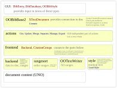
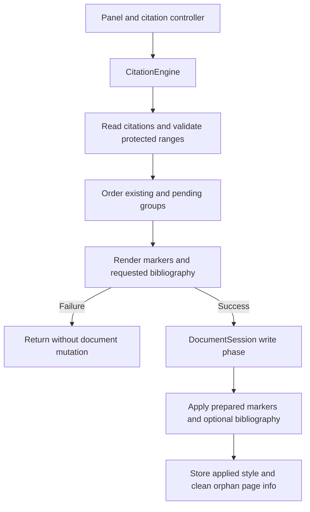

# Overview

The OpenOffice/LibreOffice panel connects JabRef libraries to a Writer document.
It inserts citations, refreshes their presentation, generates a bibliography, and exports cited entries to a library.
JStyle, CSL, and BST styles share canonical JabRef citations when Zotero compatibility mode is disabled.
Zotero compatibility mode uses a separate CSL-only strategy and native Zotero storage.

Open the panel from **View → OpenOffice/LibreOffice**.
The [user documentation](https://docs.jabref.org/cite/openofficeintegration) describes panel operations.
The [requirements](../../requirements/openoffice.md) and [ADR-0080](../../decisions/0080-canonical-writer-citations.md) define the citation compatibility contract.

## Architecture and entry points



| Area | Entry points | Responsibility |
| --- | --- | --- |
| GUI | `OpenOfficePanel`, `OpenOfficeCitationController`, `OpenOfficeDocumentConnection` | Connect to a document, select a style, obtain capabilities, and present engine results. |
| Document actions | `CitationEngine` | Coordinate insertion, refresh, merge/separate, page-info editing, and export-cited operations. |
| Group structure | `CitationGroupEditor` | Prepare replacements without mutation, then apply them in the engine's write session. |
| Rendering | `RendererFactory`, `CitationRenderer`, `RenderRequest`, `RenderResult` | Compute final markers, bibliography paragraphs when requested, and unresolved keys. |
| Cited-entry export | `CitedEntryExporter` | Resolve ordered citation keys into a library without accessing Writer. |
| Canonical storage | `MarkCodec`, `MarkStore`, `UndoableDocumentProperties`, `DocumentStateStore` | Encode identities, read citation/page-info state, register custom-property undo deltas, and store applied-style identity. |
| Ordering | `DocumentOrder` | Order within text containers, map footnotes for numbering, and use visual positions when available. |
| Document writes | `MarkWriter`, `BibliographySection`, `DocumentSession` | Apply prepared output and manage write-phase undo, locking, and change recording. |
| Zotero mode | `ZoteroCitationStrategy` | Read and write native Zotero citations with CSL rendering and source linking. |
| Citation conversion | `CitationFormatConverter`, `ConversionMetadata` | Prepare next-CSL-insertion conversion of citation marks only, preserving citation state in a document sidecar. |

The engine and renderers live in `jablib/src/main/java/org/jabref/logic/openoffice/engine/`; canonical storage is in its `storage` subpackage.
`DocumentCitations` and `DocumentOrder` are in `logic/openoffice/frontend/`.
`DocumentCitations` is an action-local facade combining a mutable `CitationGroups` model with live `MarkStore` and Writer range access, not a document subtype or immutable snapshot.
Core facade instances are named `documentCitations`; GUI controller instances are named `citationController`.
`OpenOfficeCitationController` exposes concise action methods such as `insertCitation`, `refresh`, `mergeCitations`, `separateCitations`, and `exportCited`.
`OpenOfficeDocumentConnection.disposeAllBridges()` is a global static shutdown operation: it disposes client-side UNO bridges without closing Writer documents or the office application.

Low-level UNO helpers and `OOTextWriter` are in `logic/openoffice/uno/`.
The `OOTextWriter` name pairs the consumed `OOText` representation with the `OOFormat` vocabulary; it writes through UNO rather than selecting or implementing a citation style.
The pure `OOText` and `OOFormat` model remains in `model/openoffice/ootext/`.
`WriterReferenceMark`, `WriterReferenceMarks`, and `WriterTextContext` provide concrete range helpers in `logic/openoffice/backend/` without parsing citation names.
Canonical ranges use persistent invisible boundaries; Zotero ranges use temporary boundaries removed only when safe.
The shared citation model has no UNO dependency.
JStyle citation processors and bibliography formatters operate on that model without accessing Writer.
There is no speculative bookmark backend or generic style-management framework.

## Canonical insert and refresh



Each canonical action reconstructs citation groups from the document rather than relying on a cached key/number manager.
Insertion prepares a pending group in memory so validation, ordering, and rendering finish before creating its mark.
JStyle document-style preconditions are checked during preparation.
Protected-range checks include citations, bibliography sections, pending deletions, and body footnote anchors whose footnotes contain citations.
Ordering occurs before controller locking because Writer's view cursor cannot move while controllers are locked.

Renderers do not write to Writer.
BST rendering can require Pandoc and fail; rendering finishes before the canonical write phase begins.
After preparation, `DocumentSession` groups writes in an undo context, suspends change recording, and locks controllers while applying the output.
`UndoableDocumentProperties` registers custom `XUndoAction` deltas for page-info changes and removals alongside Writer's mark/text edits.
Undo/redo uses raw property APIs during replay so it does not register further undo actions.
Ordinary applied-style and Zotero preference setters remain raw and are not made undoable by these page-info deltas.
Ordinary write sessions do not gain conversion's dedicated failure rollback.

Merge and Separate prepare proposed groups and replacement identities through `CitationGroupEditor` before changing the document.
The engine renders the proposed group list and bibliography, then applies the replacements and prepared output in one session without rendering again.
With an available, unlocked undo manager, one Undo step restores original identities, formatted text, and every page-info slot; redo restores the edited state.
A preparation/rendering failure leaves marks, properties, text, and undo history unchanged.

Insertion refreshes citation markers even when bibliography synchronization is disabled.
That preference controls whether the target mode's managed bibliography is also updated; it is not overridden merely because a bibliography already exists.
A style without a bibliography can still update citation markers without rebuilding a bibliography.
If existing citations cannot be resolved in the selected libraries, a successful insertion shows an "Unresolved citations" warning listing every returned key and advising the user to open the corresponding libraries and refresh.
The warning applies with synchronization enabled or disabled; the insertion succeeds, but existing markers may show unresolved keys, and synchronization may omit their bibliography entries.
Stored keys remain available for resolution after reopening the libraries and refreshing.

## What is stored in a document

A canonical group occupies one Writer reference mark:

```text
JABREF_<key>[, JABREF_<key2> ...] <TYPE> <uid>
```

For example:

```text
JABREF_Smith2000 NORMAL group-17
JABREF_Smith2000, JABREF_Jones2001 NORMAL group-18
```

The type precedes the uid.
`MarkCodec` has no uid-before-type fallback.
Keys are nonempty and contain neither whitespace nor commas.
Key order, including repeated keys, is storage order, not renderer sorting order.
The uid identifies the group independently of citation numbers, labels, and marker text.
A refresh or style-family change does not rename a canonical mark.
Persistent invisible boundary characters protect short and invisible canonical citations from fragile zero-length ranges.

| Stored type | Model value | Intended presentation |
| --- | --- | --- |
| `NORMAL` | `AUTHORYEAR_PAR` | Normal citation in the selected style's notation. |
| `IN_TEXT` | `AUTHORYEAR_INTEXT` | In-text citation. |
| `EMPTY` | `INVISIBLE_CIT` | Invisible marker; the source still participates in the bibliography. |
| `NOPAR` | `AUTHORYEAR_NOPAR` | Author-year without enclosing parentheses. |
| `AUTHOR_ONLY` | `AUTHOR_ONLY` | Author part only. |
| `YEAR_ONLY` | `YEAR_ONLY` | Year part only. |

### Identifier generation

`CitationIds` is the shared CUID2 generator for new canonical identities and Zotero identities/suffixes.
Its default is 24 lowercase alphanumeric characters, not a UUID, timestamp, or operation-derived hash.
New Zotero marks retain the wire-format conventions of eight characters for `citationID` and ten characters after `RND` in citation and bibliography names.
Foreign identifiers remain opaque and are not regenerated just to match those lengths.
Canonical uids are read as opaque identifiers rather than parsed as a particular generated-id format.
Generated decimal item-id collision checks use bounded decimal-string validation, not arbitrary-precision number parsing of foreign identifiers.
Merge and Separate allocate proposed identities once during preparation and retain them through rendering and application.

### Page information and style state

Per-citation page information is stored under:

```text
JabRef_page_info:<uid>:<storageIndex>
```

The zero-based index addresses the key in storage order, so renderer sorting cannot transfer page information to another citation.
Merge and Separate preserve each storage slot rather than concatenate all information into a last-citation value.
Cite special and Manage citations edit their designated slot without dropping the other slots.
Document custom properties do not travel with citation text copied to another document.

`JabRef_document_style` stores the applied family and identifier: a path for JStyle/BST or a CSL style identifier.
Selecting a style does not change the last-applied document property; a successful write does.
CSL operations also maintain Zotero preferences such as `ZOTERO_PREF`.
Ordinary `DocumentStateStore` and Zotero preference writes use raw property setters, so Undo can restore presentation without restoring their recorded style identity.
Conversion separately prepares those style-property deltas and makes its own writes undoable alongside citation edits.

`MarkWriter` keeps a bounded, connection-local baseline of formatted `OOText` per uid rather than comparing only plain Writer text.
Reconnecting clears that baseline, so unchanged text may be rewritten on the first refresh.
The baseline is not persisted as document properties.
The canonical managed bibliography uses the `JR_bib` section; JStyle retains its `JR_bib_end` hook.
Native Zotero bibliographies belong to the separate Zotero strategy, not to citation-format migration.

## Rendering, numbering, and style changes

`StyleCapabilities` describes supported insertion types, bibliography availability, page-info editing, and group editing.
JStyle supports page information and group editing; CSL and BST retain stored page information without rendering it.
Zotero mode disables page-info and group editing.
Insertion coerces unsupported new types according to capabilities, while rendering an existing canonical citation with another family does not replace its stored type.
Returning to a supporting family can restore a stored partial citation's presentation.

A render pass considers the entire cited set rather than storing a number beside each key.
Numeric CSL styles use citeproc's cluster updates and bibliography order rather than patching digits in existing text.
JStyle supports first-appearance and bibliography-sort numbering; author-year disambiguation follows the relevant cited-set order.
BST styles obtain labels and ordering from the rendered bibliography program output.
Missing canonical sources remain represented by unresolved-key placeholders rather than silently losing their stored keys.
The [ordering guide](order-of-appearance.md) describes footnote mapping and the documented limitations of visual ordering, including multi-column and side-by-side layouts.
Shared ordering is not a guarantee of correct reading order for every layout.

## Style selection and external styles

Style registries have explicit family-specific sources.
The CSL registry uses `CSLStyleLoader::getStyles`, including configured external CSL styles; it does not accidentally restrict the catalog to bundled styles.
JStyle and BST retain their bundled defaults alongside their configured external styles.
Manual style inference is CSL-only; restoration of explicitly stored applied-style metadata across families is a separate operation.
Choosing another family does not turn manual CSL inference into a JStyle/BST heuristic.

The style dialogs share the external-file picker and narrow private removal helpers, not a new generic style-management framework.
Parsers, caches, previews, and edit behavior remain family-specific.
Removing an external style is guarded by confirmation; cancellation and failures must not apply the successful-removal transition, and successful removal repairs row selection.
Removal forgets the configured style entry rather than deleting the user's style file.

## Compatibility boundary

Legacy JStyle `JR_cite*` marks and legacy CSL/BST marks containing `CID_n` are not canonical citations and are not automatically migrated.
Their existing text remains visible, but canonical reading, export-cited results, and regenerated bibliographies do not manage them.
Opening a document, selecting another family, or refreshing does not upgrade those legacy marks.
Maintaining them requires a compatible older JabRef version or manually replacing them with current canonical citations.
Keep a copy before changing which JabRef version manages an existing document.

### Current canonical ↔ native Zotero conversion

Changing the compatibility preference alone does not modify the document.
On the **next CSL citation insertion**, `CitationEngine.requiresFormatConversion` rereads current marks, including after reconnecting, and detects current-format citations that do not match the selected mode.
The controller shows the existing warning titled "Reference mark format" with the message "Converting references to selected format" before insertion mutates the document.
Opening, toggling, selecting a style, refreshing, exporting cited entries, and JStyle/BST insertions do not trigger conversion.
Only current canonical and native Zotero citation marks participate; `JR_cite*` and `CID_n` marks do not.

`CitationFormatConverter` prepares existing and pending citations, source linking, replacement identities, optional normally synchronized target bibliography output, and style-property deltas.
Required custom-property types, writability, and removability are preflighted before mutation.
One render supplies final markers and any requested bibliography output; application does not render again.
Invalid metadata, unsupported citation modifiers, unresolved sources, unsuitable properties, protected ranges, and rendering failures stop preparation before document writes or undo-history changes.

`ConversionMetadata` stores a document-local citation sidecar under `JabRef_citation_conversion:<uid>`.
It preserves the canonical uid, storage-order keys, all six stored types, every page-info slot, and supported native Zotero JSON, including URI links, opaque identifiers, and harmless unknown metadata, while the association remains valid through conversion and save/reopen.
Previously stored canonical partial types and page information survive but are not rendered in Zotero mode.
Native nonempty locators, labels, prefixes, suffixes, author-only items, and mixed per-item `suppress-author` flags are rejected before conversion or ordinary native insertion/refresh with an actionable error; uniform suppression is supported.
`ZoteroCitationModifiers` validates these modifiers before linking, rendering, or writing native updates, independently of conversion-sidecar freshness checks.
A rejected update leaves citations, bibliography, document properties, and undo history unchanged and directs the user to update the citations in Zotero; this is not locator conversion or rendering support.
Export-cited still reads these citations because it does not rewrite them.
The sidecar is not a rendered-output cache: opaque native JSON may include Zotero display properties that are preserved rather than used for rendering.

A native citation's `citationID` or mark suffix associates it with its sidecar.
An externally edited native mark that still matches that association blocks actual conversion rather than restoring stale canonical state.
This strict freshness check does not block ordinary native Zotero insertion or refresh, which continue using the current native citation without overwriting a stale sidecar.
Replacing both identity fields or deleting the sidecar loses the association; the former canonical uid, unsupported type, and page information cannot be reconstructed from that native citation alone.

Conversion changes citation marks only.
With synchronization disabled, all bibliography section names, text, and properties remain unchanged, and no bibliography is created.
With synchronization enabled and a style that has a bibliography, normal handling updates or creates only the target mode's managed bibliography and leaves other-format sections alone.
There is no bibliography conversion, renaming, consolidation, cleanup, metadata sidecar, or rejection based on bibliography settings.
Pre-existing canonical and Zotero sections may therefore coexist.

Conversion requires an available, unlocked undo manager and cannot join another undo context.
`DocumentSession.writeWithRollback` owns a root context and sentinel, making successful insertion/conversion one Undo/Redo step for citation edits, page-info and conversion metadata, prepared conversion-style properties, and any normally synchronized target bibliography.
On ordinary application failure it closes and verifies ownership of the context before undoing only its own transaction, never an earlier user action.
Starting the write transaction may clear pre-existing redo history even if rollback restores document state.
Disconnects, lost ownership, or failed rollback produce a distinct recovery error; complete recovery is not universally guaranteed and a saved copy may be needed.

### Existing undo contexts versus new property undo and rollback

The older GUI already grouped citation insertion, including conversion, in an undo context; refresh, merge, and separate also had contexts.
Those contexts grouped Writer text and mark edits, but custom document properties were not undone; the old Manage citations comment explicitly documented the page-info limitation.
`UndoableDocumentProperties` adds the custom deltas for page information and citation conversion metadata, with prepared style-property deltas additionally included for conversion.
Ordinary applied-style and Zotero preference writes remain raw and are not made undoable by this mechanism.
Owned conversion-failure rollback is new recovery behavior intended to prevent ordinary failed conversions from leaving partially replaced citations, not the first introduction of undo grouping.

## Verification and further reading

The [Writer integration testing instructions](../testing.md#libreoffice-writer-integration-tests) describe the required LibreOffice/Pandoc setup, dedicated task, standard test reports, and saved documents/logs.
Golden documents, cross-family save/reopen, citation-mode conversion, all types/page slots, native JSON, protected ranges, superscripts, tracked changes, and rollback are covered by the relevant Writer and unit-test definitions.
The native locator fixture establishes unchanged content on rejection, not successful locator conversion.
These descriptions do not establish that a particular run passed or remove the documented ordering limitations.
The [code reorganization](code-reorganization.md) and [problems](problems.md) pages preserve historical design evidence rather than define the current contract.
For repository exploration, see [JabRef on DeepWiki](https://deepwiki.com/JabRef/jabref).
