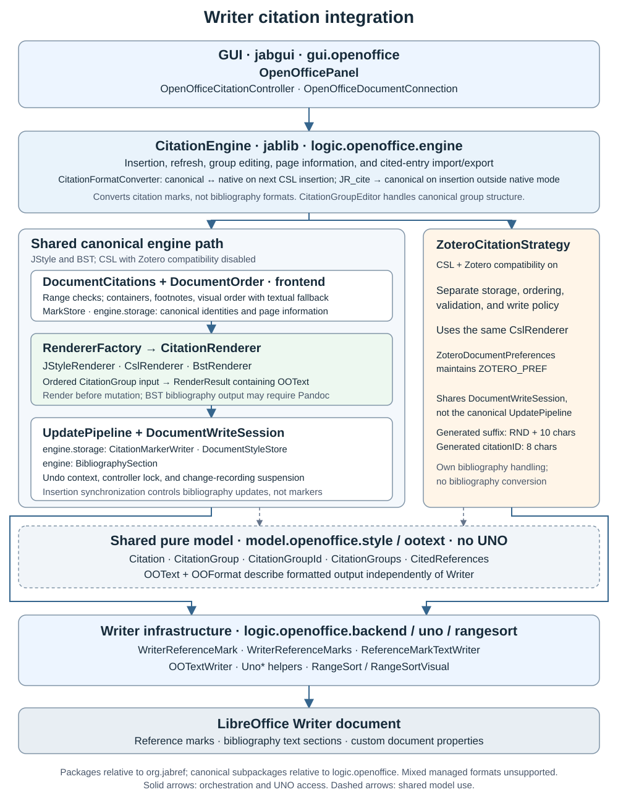
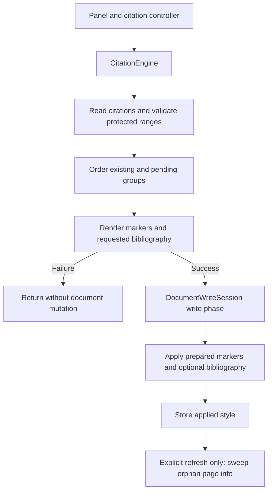

# Overview

The OpenOffice/LibreOffice panel connects JabRef libraries to a Writer document.
It inserts citations, refreshes their presentation, generates a bibliography, exports cited entries, and imports entries embedded in Zotero-compatible documents.
JStyle and BST always use canonical JabRef citations; CSL uses them when Zotero compatibility mode is disabled.
Zotero compatibility mode uses a separate CSL-only strategy and native Zotero storage.

Open the panel from **View → OpenOffice/LibreOffice**.
The [user documentation](https://docs.jabref.org/cite/openofficeintegration) describes panel operations.
The [requirements](../../requirements/openoffice.md) and [ADR-0084](../../decisions/0084-canonical-writer-citations.md) define the citation compatibility contract.

## Architecture and entry points



| Area | Entry points | Responsibility |
| --- | --- | --- |
| GUI | `OpenOfficePanel`, `OpenOfficeCitationController`, `OpenOfficeDocumentConnection` | Connect to a document, select a style, obtain capabilities, and present engine results. |
| Document actions | `CitationEngine` | Coordinate insertion, refresh, merge/separate, page-info editing, and export-cited operations. |
| Group structure | `CitationGroupEditor` | Prepare replacements without mutation, then apply them in the engine's write session. |
| Rendering | `RendererFactory`, `CitationRenderer`, `RenderRequest`, `RenderResult` | Compute final markers, bibliography paragraphs when requested, and unresolved keys. |
| Cited-entry export | `CitedEntryExporter` | Resolve ordered citation keys into a library without accessing Writer. |
| Cited-entry import | `CitationEngine.importCited`, `CitedEntryCollector` | Collect embedded Zotero entries read-only for the library import flow. |
| Canonical storage | `JabRefMarkCodec`, `MarkStore`, `UndoableDocumentProperties`, `DocumentStyleStore` | Encode identities, read citation/page-info state, register custom-property undo deltas, and store applied-style identity. |
| Ordering | `DocumentOrder` | Order within text containers, map footnotes for numbering, and use visual positions when available. |
| Document writes | `CitationMarkerWriter`, `BibliographySection`, `DocumentWriteSession` | Apply prepared output and manage write-phase undo, locking, and change recording. |
| Zotero mode | `ZoteroCitationStrategy` | Read and write native Zotero citations with CSL rendering and source linking. |
| Citation conversion | `CitationFormatConverter`, `ConversionMetadata` | Prepare next-CSL-insertion conversion of citation marks only, preserving citation state in a document sidecar. |

The engine and renderers live in `jablib/src/main/java/org/jabref/logic/openoffice/engine/`; canonical storage is in its `storage` subpackage.
`DocumentCitations` and `DocumentOrder` are in `logic/openoffice/frontend/`.
`DocumentCitations` is an action-local facade combining a mutable `CitationGroups` model with live `MarkStore` and Writer range access, not a document subtype or immutable snapshot.
Core facade instances are named `documentCitations`; GUI controller instances are named `citationController`.
`OpenOfficeCitationController` exposes concise action methods such as `insertCitation`, `refresh`, `mergeCitations`, `separateCitations`, `exportCited`, and `importCited`.
`OpenOfficeDocumentConnection.disposeAllBridges()` is a global static shutdown operation: it disposes client-side UNO bridges without closing Writer documents or the office application.

Low-level UNO helpers and `OOTextWriter` are in `logic/openoffice/uno/`.
The `OOTextWriter` name pairs the consumed `OOText` representation with the `OOFormat` vocabulary; it writes through UNO rather than selecting or implementing a citation style.
The pure `OOText` and `OOFormat` model is in `model/openoffice/ootext/`.
`WriterReferenceMark`, `WriterReferenceMarks`, and `WriterTextContext` provide concrete range helpers in `logic/openoffice/backend/` without parsing citation names.
Canonical ranges use persistent invisible boundaries; Zotero ranges use temporary boundaries removed only when safe.
The shared citation model has no UNO dependency.
JStyle citation processors and bibliography formatters operate on that model without accessing Writer.
There is no speculative bookmark backend or generic style-management framework.

## Canonical insert and refresh



Each canonical action reconstructs citation groups from the document rather than relying on a cached key/number manager.
Insertion prepares a pending group in memory so validation, ordering, and rendering finish before creating its mark.
JStyle bibliography paragraph styles are validated during preparation only when bibliography output is requested.
Protected-range checks include citations, bibliography sections, pending deletions, and body footnote anchors whose footnotes contain citations.
Ordering occurs before controller locking because Writer's view cursor cannot move while controllers are locked.

Renderers do not write to Writer.
BST rendering can require Pandoc and fail; rendering finishes before the canonical write phase begins.
After preparation, `DocumentWriteSession` groups writes in an undo context, suspends change recording, and locks controllers while applying the output.
`UndoableDocumentProperties` registers custom `XUndoAction` deltas for page-info changes and removals alongside Writer's mark/text edits.
Undo/redo uses raw property APIs during replay so it does not register further undo actions.
Ordinary applied-style setters use raw property APIs and are not covered by these page-info undo deltas.
Ordinary write sessions group edits for undo but do not roll back failed operations automatically.

Merge and Separate prepare proposed groups and replacement identities through `CitationGroupEditor` before changing the document.
The engine renders the proposed group list and bibliography, then applies the replacements and prepared output in one session without rendering again.
With an available, unlocked undo manager, one Undo step restores original identities, formatted text, and every page-info slot; redo restores the edited state.
A preparation/rendering failure leaves marks, properties, text, and undo history unchanged.

Insertion refreshes citation markers even when bibliography synchronization is disabled.
That preference controls whether the target mode's managed bibliography is also updated; it is not overridden merely because a bibliography already exists.
A style without a bibliography can still update citation markers without rebuilding a bibliography.
If existing citations cannot be resolved in the selected libraries, a successful insertion shows an "Unresolved citations" warning listing every returned key and advising the user to open the corresponding libraries and refresh.
The warning applies with synchronization enabled or disabled; the insertion succeeds, but existing markers may show unresolved keys, and synchronization may omit their bibliography entries.
Stored keys remain available for resolution after reopening the libraries and refreshing.

## Importing cited entries

**Import cited** reads bibliographic data embedded in native Zotero-compatible reference marks, including JabRef-linked marks in that format.
It ignores canonical JabRef and legacy marks, which do not embed the required entry data.
Unlike **Export cited**, it does not resolve citation keys against open libraries to collect the entries.

`OpenOfficePanel` captures the active `LibraryTab` before collection and delegates through `OpenOfficeCitationController.importCited()` to `CitationEngine.importCited()`.
The engine uses `CitedEntryCollector` to collect embedded entries without a write session, document mutation, or citation-format conversion, independently of the selected compatibility mode.
The panel passes the result to the captured tab's normal `ImportHandler`, so changing the active tab does not retarget the import.
Missing library or document prerequisites are reported before collection.

Collection prefers native item URIs, then explicit document keys, then fallback numeric item IDs.
Only citations with the same selected identity are deduplicated, preserving the first collected position and bibliographic data; a later explicit key is retained when the first citation with that identity was keyless.
Key-only and URI-bearing representations remain separate even when their keys match, and both reach the serialized ordinary bibliographic duplicate handler.
An extra duplicate prompt is safer than dropping a potentially unrelated publication based solely on a shared key.

For cited-entry imports, the handler serializes each complete duplicate search, user decision, key adjustment, and insertion before starting the next entry's search.
This lets later entries find earlier accepted bibliographic duplicates without changing general imports' concurrent processing or preference behavior.
All explicit batch keys are reserved before generating keys for keyless entries, including during suffix selection.
When batch reservations are supplied, generated-key collision checks use each candidate's final normalized form against both reserved keys and existing library keys.
If an unrelated library entry owns an explicit document key, the handler warns and declines that entry's insertion rather than renaming it or creating duplicate keys.
Replacing or merging a duplicate is also declined with a warning if the outcome would silently drop another explicit key from the cited batch.
The [import requirements](../../requirements/import.md#user-can-import-cited-entries-from-zotero-compatible-libreoffice-documents) define identity collection, key preservation, and batch duplicate handling.

## What is stored in a document

A canonical group occupies one Writer reference mark:

```text
JABREF_<key>[, JABREF_<key2> ...] <TYPE> <uid>
```

For example:

```text
JABREF_Smith2000 NORMAL a1b2c3d4e5
JABREF_Smith2000, JABREF_Jones2001 NORMAL f6g7h8i9j0
```

The type precedes the uid.
`JabRefMarkCodec` has no uid-before-type fallback.
Keys are nonempty and contain neither whitespace nor commas.
Key order, including repeated keys, is storage order, not renderer sorting order.
The uid identifies the group independently of citation numbers, labels, and marker text.
A refresh or style-family change does not rename a canonical mark.
Persistent invisible boundary characters protect short and invisible canonical citations from fragile zero-length ranges.

| Stored type | Model value | Intended presentation |
| --- | --- | --- |
| `NORMAL` | `AUTHORYEAR_PAR` | Normal citation in the selected style's notation. |
| `IN_TEXT` | `AUTHORYEAR_INTEXT` | In-text citation. |
| `EMPTY` | `INVISIBLE_CIT` | Invisible marker; the source still participates in the bibliography. |
| `NOPAR` | `AUTHORYEAR_NOPAR` | Author-year without enclosing parentheses. |
| `AUTHOR_ONLY` | `AUTHOR_ONLY` | Author part only. |
| `YEAR_ONLY` | `YEAR_ONLY` | Year part only. |

### Identifier generation

`CitationIds.newId()` generates ten-character CUID2 group uids using lowercase letters and digits, with a letter as the first character.
The uid appears directly after the citation type in the mark name.
Reading a stored uid does not require it to match the generated length or CUID2 alphabet; the codec accepts ASCII letters, digits, underscores, and hyphens.
Reading, refreshing, and changing styles do not regenerate a stored uid.
Merge and Separate allocate proposed identities once during preparation and use them throughout rendering and application.

### Page information and style state

Per-citation page information is stored under:

```text
JabRef_page_info:<uid>:<storageIndex>
```

The zero-based index addresses the key in storage order, so renderer sorting cannot transfer page information to another citation.
Merge and Separate preserve each storage slot rather than concatenate all information into a last-citation value.
Cite special and Manage citations edit their designated slot without dropping the other slots.
Only explicit refresh sweeps all orphan page-info properties; insertion, merge, separation, and conversion still remove properties for citations they replace or remove.
Document custom properties do not travel with citation text copied to another document.

`JabRef_document_style` stores the applied family and identifier: a path for JStyle/BST or a CSL style identifier.
Selecting a style does not change the last-applied document property; a successful write does.
This metadata supports manual CSL inference and citation-format conversion, not automatic style selection.
Ordinary `DocumentStyleStore` writes use raw property setters, so Undo can restore presentation without restoring the recorded style identity.
Conversion separately prepares those style-property deltas and makes its own writes undoable alongside citation edits.

`CitationMarkerWriter` keeps a bounded, connection-local baseline of formatted `OOText` per uid rather than comparing only plain Writer text.
Reconnecting clears that baseline, so unchanged text may be rewritten on the first refresh.
The baseline is not persisted as document properties.
The canonical managed bibliography uses the `JR_bib` section; JStyle uses the `JR_bib_end` hook.

### Zotero-compatible storage

`ZoteroCitationStrategy` reads and writes the native citation format, separate from canonical marks.
JabRef generates an eight-character CUID2 value for the JSON `citationID` field, which identifies the citation group.
Citation and bibliography mark names have an `RND` suffix followed by ten random lowercase letters and digits generated with CUID2.
The JSON `citationID` and the `RND` suffix are separate identifiers; neither is a cited source's item ID.
Stored JSON `citationID` values can have other lengths and are not regenerated during reading.
Generated decimal item-ID collision checks use bounded decimal-string validation, not arbitrary-precision number parsing of foreign identifiers.
Only native-mode insertion and refresh update `ZOTERO_PREF` XML through raw property setters; conversion targeting native mode records its prepared preference changes for undo.
Canonical CSL operations and conversions targeting canonical format leave that XML untouched while still updating JabRef's applied-style identity.
Native bibliographies are handled by the citation strategy, not migrated between formats.

## Rendering, numbering, and style changes

`StyleCapabilities` describes supported insertion types, bibliography availability, page-info editing, and group editing.
JStyle supports page information and group editing; CSL and BST retain stored page information without rendering it.

Insertion coerces unsupported new types according to capabilities, while rendering an existing canonical citation with another family does not replace its stored type.
Returning to a supporting family can restore a stored partial citation's presentation.
The canonical CSL renderer supports author-only and year-only choices in Cite special using fixed JabRef formatting.
Author-only uses short author names, then editor names, then the citation key; year-only uses the resolved year, then a parsed date year, then the citation key.
Multiple entries retain storage order and repetitions and are joined with semicolons.
These are style-independent approximations: explicit year suffixes survive, but CSL-specific name formatting and processor-generated disambiguation suffixes are not reproduced, and year-only is not a general CSL author-suppression operation.
Page information and the no-parentheses choice are disabled for CSL; the canonical CSL renderer supports invisible citations.

A render pass considers the entire cited set rather than storing a number beside each key.
Numeric CSL styles use citeproc's cluster updates and bibliography order rather than patching digits in existing text.
JStyle supports first-appearance and bibliography-sort numbering; author-year disambiguation follows the relevant cited-set order.
BST styles obtain labels and ordering from the rendered bibliography program output, except that `AUTHOR_YEAR` notation without requested bibliography output skips BST execution.
Other BST notations retain their program-derived labels and ordering.
Missing canonical sources remain represented by unresolved-key placeholders rather than silently losing their stored keys.
The [ordering guide](order-of-appearance.md) describes footnote mapping and the documented limitations of visual ordering, including multi-column and side-by-side layouts.
Shared ordering is not a guarantee of correct reading order for every layout.

### Zotero-compatible rendering

Native insertion supports only normal (`AUTHORYEAR_PAR`) and narrative (`AUTHORYEAR_INTEXT`) citations; it does not offer invisible or partial-citation choices.
Page-info and group editing are disabled in this mode.
Native JSON determines the normal or narrative type; empty or zero-width mark text does not imply invisibility.
See the [compatibility boundary](#compatibility-boundary) for modifier handling and metadata preservation.

## Style selection and external styles

The panel's Settings menu provides More settings, which opens JabRef preferences with the OpenOffice/LibreOffice tab selected, even without a connected Writer document.
Zotero compatibility applies only to CSL styles; JStyle and BST always use JabRef citations without requiring a manual mode change.
Switching to JStyle or BST retains the saved CSL compatibility preference, so returning to CSL uses the previous on/off choice.
The Zotero preference is disabled for non-CSL styles, and saving other integration settings does not overwrite that choice.

Style registries have explicit family-specific sources.
The CSL registry uses `CSLStyleLoader::getStyles` to include bundled and configured external styles.
JStyle and BST include their bundled defaults alongside their configured external styles.
Each loader's `getStyles()` returns a detached, unmodifiable list snapshot with internal styles first.
CSL uses static shared style lists and a generated metadata catalog, with lazy loading of built-in style sources.

Each loader owns its guarded boolean `addExternalStyle(...)` and `removeStyle(...)` operations and persists its family's external paths only after an accepted addition or actual removal.
Internal styles cannot be added as external styles or removed; rejected and no-op mutations do not write preferences.
Duplicate checks preserve each family's policy:

- CSL compares full titles or matching nonblank short titles against external styles and built-in metadata, without loading built-in sources.
- BST compares case-sensitive, extension-stripped names against external and built-in styles.
- JStyle checks parsed-style equality against its external list.

`StyleSelectDialogViewModel.storeStylePreferences()` saves only the selected style and BST citation notation, never reconstructing external-path lists from dialog rows.
Keeping one writer per family's external-path list prevents a stale dialog snapshot from overwriting registry changes.
Adding CSL or BST styles applies the added style immediately; adding a JStyle selects its row but defers applying it until the dialog is confirmed.

For style preparation, `OpenOfficePanel` calls `JStyle.ensureUpToDate()` directly on the actual selected JStyle; CSL and BST instances are left untouched.
The panel retains the last selected style from global preferences at startup and when connecting to or selecting a Writer document.
No style family is inferred or restored automatically from document metadata.
Manual **Infer style** is available only with a CSL style selected and a connected Writer document.
It uses the package-private `CslStyleResolver.resolve(XTextDocument)` to resolve document metadata against the current styles from a live `Supplier<List<CitationStyle>>`.
Choosing another family does not turn manual CSL inference into a JStyle/BST heuristic.

The style dialogs share the external-file picker and private removal helpers.
Parsers, caches, previews, and edit behavior are family-specific.
Each non-null style selection loads its preview when the dialog opens or the selection changes, regardless of the active tab.
Removing an external style is guarded by confirmation; cancellation and failures must not apply the successful-removal transition, and successful removal repairs row selection.
Removal forgets the configured style entry rather than deleting the user's style file.

## Compatibility boundary

Legacy JStyle `JR_cite*` marks and legacy CSL/BST marks containing `CID_n` are not canonical citations.
Until supported JStyle marks are migrated on insertion, their text remains visible but canonical reading, export-cited results, and regenerated bibliographies do not manage them.
`CID_n` remains unmanaged and is not a migration input; maintaining unsupported legacy citations requires a compatible older JabRef version or manual replacement.
Keep a copy before changing which JabRef version manages an existing document.

Supported source documents use one homogeneous citation format: canonical `JABREF_<keys> <TYPE> <uid>`, supported legacy JStyle `JR_cite` names, or native Zotero citation names.
Mixed-source conversion is unsupported; no mixed-format repair is promised.
On each insertion, `CitationEngine.requiresFormatConversion` reads fresh reference-mark names from Writer, including after reconnecting, and uses only the first recognized name.
It skips unrelated marks and unsupported `CID_n` marks, does not scan for later mismatching formats, and requires no conversion if no recognized name exists.
UNO does not guarantee sorted name enumeration or physical document order; enumeration order is immaterial for homogeneous documents.
This name-only decision leaves the existing conversion group-reading and preparation path unchanged.

### One-way legacy JStyle migration on insertion

The next insertion outside effective native Zotero mode migrates a homogeneous legacy JStyle document when fresh detection selects a supported `JR_cite` name as the first recognized name returned by Writer.
JStyle and BST always use canonical mode, even if the saved CSL Zotero setting is on; CSL uses canonical mode when that setting is off.
Before mutation, the controller shows the "Reference mark format" / "Converting references to selected format" warning.
Connecting, refreshing, exporting, selecting a style, or changing the preference alone does not migrate marks.
Insertion or conversion targeting native Zotero format leaves legacy JStyle marks unchanged.

After detection selects migration, the existing preparation path handles citation groups and the pending citation.
Mixed-source conversion is unsupported.
Legacy-only migration permits unresolved entries, using ordinary canonical placeholders and the successful-insertion warning; opening the missing libraries and refreshing restores resolved output.
Legacy numeric types `1` through `6` map respectively to `NORMAL`, `IN_TEXT`, `EMPTY`, `NOPAR`, `AUTHOR_ONLY`, and `YEAR_ONLY`.
Each migrated group receives a fresh stable uid and retains its keys in storage order.
The legacy page property is named by the whole legacy mark; its value moves to the last citation's canonical `JabRef_page_info:<uid>:<storageIndex>` slot in storage order.
Legacy marks are replaced with canonical marks using invisible boundaries, not retained as an alternative output format.

The combined proposed set and any normally synchronized target bibliography are rendered once before writes, with no second render during application.
Mark replacement does not validate bibliography paragraph styles or convert bibliography sections.
The insertion coordinator separately applies optional bibliography output only when synchronization is requested; otherwise a later refresh can generate a bibliography from the migrated marks.
Migration uses the conversion transaction and the preflight, rollback, and recovery limits described below.
Insertion and migration are one Undo/Redo step, including legacy mark removal, canonical identities, page-property transfer, and prepared conversion properties.
Undo restores the legacy marks and their page properties; redo restores the same prepared canonical identities.
After migration, ordinary canonical refresh, style-family changes, and export-cited lookup manage these citations.

### Current canonical ↔ native Zotero conversion

Changing the compatibility preference alone does not modify the document.
On the **next CSL citation insertion**, the fresh first-recognized-name decision requires conversion when that name identifies canonical or native Zotero format that differs from the selected compatibility mode.
The controller shows the warning titled "Reference mark format" with the message "Converting references to selected format" before insertion mutates the document.
Opening, toggling, selecting a style, refreshing, exporting cited entries, and JStyle/BST insertions do not trigger canonical ↔ native Zotero conversion.
This bidirectional conversion concerns homogeneous canonical or native Zotero source documents; supported legacy JStyle input follows the separate one-way migration above.
Conversion targeting native Zotero format does not migrate `JR_cite*`, and `CID_n` never participates.

Once detection triggers conversion, `CitationFormatConverter` prepares citations, source linking when needed, replacement identities, optional normally synchronized target bibliography output, and style-property deltas.
Flattened entry data and native item-ID preparation are limited to native output; an empty native citation set skips source linking.
Required custom-property types, writability, and removability are preflighted before mutation.
One render supplies final markers and any requested bibliography output; application does not render again.
Native-to-canonical conversion and native generation require resolved sources; the unresolved-entry allowance applies only to legacy-only canonical migration.
Invalid metadata, required but unresolved sources, unsuitable properties, protected ranges, and rendering failures stop preparation before document writes or undo-history changes.

`ConversionMetadata` stores a document-local citation sidecar under `JabRef_citation_conversion:<uid>`.
Sidecars are indexed once per action without a persistent lookup cache; parsing, identity, freshness, and property-safety checks remain in force.
It preserves the canonical uid, storage-order keys, all six stored types, every page-info slot, and supported native Zotero JSON, including URI links, opaque identifiers, and harmless unknown metadata, while the association remains valid through conversion and save/reopen.
Canonical `EMPTY` and canonical-only partial types use the normal visible citation fallback in Zotero mode; page information remains stored but is not rendered.
Converting back restores the canonical uid, storage-order keys, stored type, and page information from the sidecar, including invisible rendering for `EMPTY`.
Native modifiers do not introduce a rejection in format conversion, insertion, or refresh.
When citations are regenerated, locators and affixes are not rendered, author-only is ignored, and any item with `suppress-author: true` selects group-level in-text/narrative rendering, including mixed groups.
Native JSON remains in native marks or the conversion sidecar, which restores the original modifiers when converting back; retaining metadata is not full modifier rendering support.
Export-cited is read-only.
The sidecar is not a rendered-output cache: opaque native JSON may include Zotero display properties that are preserved rather than used for rendering.

A native citation's `citationID` or mark suffix associates it with its sidecar.
An externally edited native mark that still matches that association blocks actual conversion rather than restoring stale canonical state.
This strict freshness check does not block ordinary native Zotero insertion or refresh, which continue using the current native citation without overwriting a stale sidecar.
Replacing both identity fields or deleting the sidecar loses the association; the former canonical uid, unsupported type, and page information cannot be reconstructed from that native citation alone.

Conversion changes citation marks only.
With synchronization disabled, all bibliography section names, text, and properties remain unchanged, and no bibliography is created.
With synchronization enabled and a style that has a bibliography, normal handling updates or creates only the target mode's managed bibliography and leaves other-format sections alone.
There is no bibliography conversion, renaming, consolidation, cleanup, metadata sidecar, or rejection based on bibliography settings.
Pre-existing canonical and Zotero sections may therefore coexist.

Conversion requires an available, unlocked undo manager and cannot join another undo context.
`DocumentWriteSession.writeWithRollback` owns a root context and sentinel, making successful insertion/conversion one Undo/Redo step for citation edits, page-info and conversion metadata, prepared conversion-style properties, and any normally synchronized target bibliography.
On ordinary application failure it closes and verifies ownership of the context before undoing only its own transaction, never an earlier user action.
Starting the write transaction may clear pre-existing redo history even if rollback restores document state.
Disconnects, lost ownership, or failed rollback produce a distinct recovery error; complete recovery is not universally guaranteed and a saved copy may be needed.

### Undo grouping, property undo, and rollback

Insertion, conversion, refresh, merge, and separate group Writer text and mark edits in undo contexts.
Writer's undo mechanism does not automatically restore custom document properties.
`UndoableDocumentProperties` registers custom deltas for page information and citation conversion metadata, with prepared style-property deltas included for conversion.
Ordinary applied-style and document-preference writes use raw property APIs and are not covered by these custom undo actions.
Conversion-failure rollback undoes only the failed operation's owned transaction; grouping edits for manual Undo is not sufficient for automatic failure recovery.

## Verification and further reading

The [Writer integration testing instructions](../testing.md#libreoffice-writer-integration-tests) describe the required LibreOffice/Pandoc setup, dedicated task, standard test reports, and saved documents/logs.
Golden documents, cross-family save/reopen, citation-mode conversion, all types/page slots, native JSON, protected ranges, superscripts, tracked changes, and rollback are covered by the relevant Writer and unit-test definitions.
Native modifier fixtures cover successful conversion with the group-level citation-type mapping and JSON restoration through save/reopen; they do not establish full modifier rendering support.
These descriptions do not establish that a particular run passed or remove the documented ordering limitations.
The [package layout and ownership guide](code-reorganization.md) maps these responsibilities to current source packages and entry points.
The [problems page](problems.md) is a record of historical design evidence, not the current contract.
For repository exploration, see [JabRef on DeepWiki](https://deepwiki.com/JabRef/jabref).
