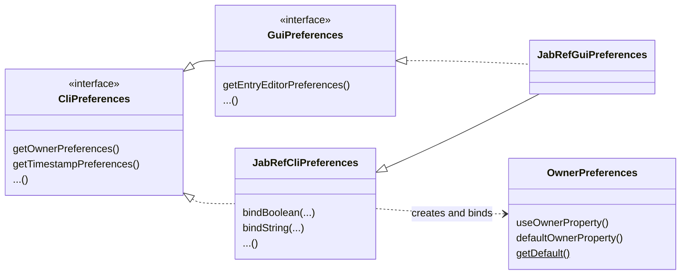

# Preferences

JabRef stores user settings using the JDK's [`java.util.prefs`](https://docs.oracle.com/en/java/javase/25/docs/api/java.prefs/java/util/prefs/Preferences.html) API, below the node `/org/jabref`.
On Windows, this is the registry; on Linux and macOS, it is a file in the user's home directory.
If a file `jabref.xml` exists in the working directory, its contents are imported into the backing store on startup.

## Abstraction layer

No code except the preferences implementation itself accesses `java.util.prefs` directly.
Instead, there are three layers:



1. **Preference objects** (e.g., `org.jabref.logic.preferences.OwnerPreferences`, `org.jabref.logic.preferences.TimestampPreferences`).
   Each groups the settings of one topic.
   They hold JavaFX properties (`BooleanProperty`, `StringProperty`, `ObservableList`, ...) and know nothing about how they are stored.
   They are mutable: changing a property changes the setting for the whole application (see [ADR-0016](../decisions/0016-mutable-preferences-objects.md)).
2. **Interfaces** `org.jabref.logic.preferences.CliPreferences` (in `jablib`) and `org.jabref.gui.preferences.GuiPreferences` (in `jabgui`, extending `CliPreferences`).
   They offer getters for the preference objects, e.g., `getOwnerPreferences()`.
3. **Implementations** `org.jabref.logic.preferences.JabRefCliPreferences` and `org.jabref.gui.preferences.JabRefGuiPreferences`.
   They are the only classes knowing the keys in the backing store.
   On first access of a getter, the preference object is created from the stored values (falling back to the defaults) and cached.
   Then, each property is *bound* to its key using one of the `bind*` helpers (`bindBoolean`, `bindString`, `bindObject`, `bindPathList`, `bindMap`, `bindCustom`, ...).
   A binding writes every change of the property immediately to the backing store and registers the property for the bulk operations "reset" (`clear()`) and "import" (`importPreferences(...)`).

### Using preferences in code

* `org.jabref.model` and `org.jabref.logic` must not know `CliPreferences` or `GuiPreferences`.
  Pass only the preference objects that are really needed, e.g., `UpdateField.setAutomaticFields(entries, ownerPreferences, timestampPreferences)`.
  This keeps the dependencies explicit and the logic easy to test.
* GUI code obtains the preferences object via dependency injection (see [ADR-0055](../decisions/0055-dependency-injection-approach.md)) and hands the needed preference objects on.
* Since preference objects are observable, code which must react on a changed setting listens to the property instead of re-reading the value.
* In tests, create the preference objects directly or mock them. See [Preferences in tests](testing.md#preferences-in-tests).

### Preferences dialog

Each tab of the preferences dialog implements `org.jabref.gui.preferences.PreferencesTab` and has a view model.
The view model copies the values from the preference objects into its own properties in `setValues()` and writes them back in `storeSettings()` (when the user clicks "Save").
Thus, the user can cancel the dialog without the preferences being changed.
See `org.jabref.gui.preferences.entry.EntryTabViewModel` for an example.

How the search of the preferences dialog finds the settings is described in [ADR-0069](../decisions/0069-preferences-search-registration-vs-scene-graph-scan.md).

## How to deal with defaults

The default values belong to the preference object, not to the preferences implementation.
Each preference object offers a private no-argument constructor setting the defaults and a static `getDefault()` method:

```java
public class OwnerPreferences {
    private static final String DEFAULT_OWNER = System.getProperty("user.name");

    // ...

    private OwnerPreferences() {
        this(
                false,         // useOwner
                DEFAULT_OWNER, // defaultOwner
                false          // overwriteOwner
        );
    }

    public static OwnerPreferences getDefault() {
        return new OwnerPreferences();
    }
}
```

The implementation reads the defaults from there, both for loading and for binding:

```java
public OwnerPreferences getOwnerPreferences() {
    if (ownerPreferences != null) {
        return ownerPreferences;
    }

    OwnerPreferences defaultValues = OwnerPreferences.getDefault();

    ownerPreferences = new OwnerPreferences(
            getBoolean(OWNER_ENABLE, defaultValues.shouldUseOwner()),
            get(OWNER_DEFAULT, defaultValues.getDefaultOwner()),
            getBoolean(OWNER_OVERWRITE, defaultValues.shouldOverwriteOwner()));

    bindBoolean(ownerPreferences.useOwnerProperty(), OWNER_ENABLE, defaultValues.shouldUseOwner());
    // ...

    return ownerPreferences;
}
```

This way,

* there is a single place for each default value,
* code in `jablib` (e.g., `jabkit` or tests) can use the defaults without the preferences backend (`OwnerPreferences.getDefault()`),
* "Reset preferences" restores exactly these values, because every binding remembers its default,
* `getDefaults()` can list all defaults, e.g., for the dialog listing all preferences (`PreferencesFilterDialog`).

Further rules:

* Only values set by the user are written to the backing store. A missing key means "use the default". Thus, a changed default in a new JabRef version reaches all users who did not change the setting.
* Defaults depending on the user's language must not be localized when the preferences are initialized, because the language may change later. See [ADR-0023](../decisions/0023-localized-preferences.md).
* Defaults depending on the operating system (e.g., paths, commands) are computed in the preference object, too, e.g., using `org.jabref.logic.os.OS`.
* Secrets (passwords, API keys, tokens) are not stored in the backing store but in the system keyring.

## Adding a new preference

1. Add a property with getter, setter, and property accessor to the matching preference object (or create a new preference object for a new topic).
2. Add the default value to the private default constructor.
3. Add a key constant to `JabRefCliPreferences` (or `JabRefGuiPreferences` for GUI-only settings) in the region of the preference object.
4. Read the stored value and bind the property in the getter of the preference object.
5. For a new preference object, add its getter to `CliPreferences` (or `GuiPreferences`) and call it in `initializeAll()`, so that it takes part in reset and import.
6. Expose the setting in the matching tab of the preferences dialog.

## Changing the storage format

When a key is renamed or the stored format changes, existing user settings have to be migrated.
Add a migration to `org.jabref.migrations.PreferencesMigrations` and a test for it.
[ADR-0078](../decisions/0078-store-custom-application-arguments.md) is an example of such a change.

## Related decisions

* [ADR-0016: Mutable preferences objects](../decisions/0016-mutable-preferences-objects.md)
* [ADR-0023: Localized preferences](../decisions/0023-localized-preferences.md)
* [ADR-0055: Dependency injection approach](../decisions/0055-dependency-injection-approach.md)
* [ADR-0068: Use a preference to handle Zotero reference marks](../decisions/0068-use-a-preference-for-Zotero-compatibility-mode.md)
* [ADR-0069: Collect preferences search targets by builder registration](../decisions/0069-preferences-search-registration-vs-scene-graph-scan.md)
* [ADR-0078: Store custom application arguments separately](../decisions/0078-store-custom-application-arguments.md)
