# Dialog Font Preference Investigation

## Evidence Notes

- **Manual observation:** Behavior seen while testing the application.
- **Source-confirmed:** Verified from the source code.
- **Untested:** Font-size behavior was not checked.
- **Possible cause:** A suspected reason that has not been confirmed.

Source code alone does not prove a visual problem. Untested dialogs should not be described as passing or failing.

## Dialog Inventory

| Dialog                                         | How to open                                                                                              | Source file                                                                                                                                                                                                                                                                                                                                                                                                  | Font-Size Behaviour                                                                                                                                                                                                                                                                                  | Evidence                                                                                                                                                                                                                                                                                                               |
|------------------------------------------------|----------------------------------------------------------------------------------------------------------|--------------------------------------------------------------------------------------------------------------------------------------------------------------------------------------------------------------------------------------------------------------------------------------------------------------------------------------------------------------------------------------------------------------|------------------------------------------------------------------------------------------------------------------------------------------------------------------------------------------------------------------------------------------------------------------------------------------------------|------------------------------------------------------------------------------------------------------------------------------------------------------------------------------------------------------------------------------------------------------------------------------------------------------------------------|
| API Key                                        | preferences → web search → configure API key (for a customizable fetcher)                                | `jabgui/src/main/java/org/jabref/gui/preferences/websearch/WebSearchTab.java`; `jabgui/src/main/java/org/jabref/gui/preferences/websearch/ApiKeyDialog.java`; `jabgui/src/main/resources/org/jabref/gui/preferences/websearch/ApiKeyDialog.fxml`                                                                                                                                                             | Compared at 9 and 16: text truncates at 16 but fits at 9.                                                                                                                                                                                                                                            | API Key label and Test connection button text truncate at 16.                                                                                                                                                                                                                                                          |
| Cleanup                                        | quality → clean up entries (This requires an open library)                                               | `jabgui/src/main/java/org/jabref/gui/cleanup/CleanupAction.java`; `jabgui/src/main/java/org/jabref/gui/cleanup/CleanupDialog.java`; `jabgui/src/main/resources/org/jabref/gui/cleanup/CleanupDialog.fxml`                                                                                                                                                                                                    | Compared at 9 and 16: tab overflow and filename-pattern truncation occur at 16; these fit better at 9.                                                                                                                                                                                               | At 16, the first tab is partly clipped and an overflow dropdown appears.                                                                                                                                                                                                                                               |
| Add New File Type                              | preferences → external file types → Add new file type                                                    | `jabgui/src/main/java/org/jabref/gui/preferences/externalfiletypes/EditExternalFileTypeEntryDialog.java`; `jabgui/src/main/resources/org/jabref/gui/preferences/externalfiletypes/EditExternalFileTypeEntryDialog.fxml`                                                                                                                                                                                      | Compared at 9 and 16: labels and fields overlap at 16.                                                                                                                                                                                                                                               | At 16, some labels are cut off or touch the fields. The Name, Extension, and MIME type fields appear to overlap. The Application controls look crowded. At 9, these problems are less noticeable.                                                                                                                      |
| Replace String                                 | Edit → find and replace (This requires an open library)                                                  | `jabgui/src/main/java/org/jabref/gui/edit/ReplaceStringAction.java`; `jabgui/src/main/java/org/jabref/gui/edit/ReplaceStringView.java`; `jabgui/src/main/resources/org/jabref/gui/edit/ReplaceString.fxml`                                                                                                                                                                                                   | Compared at 9 and 16: labels truncate at 16 but fit at 9.                                                                                                                                                                                                                                            | At 16, some labels are truncated. At 9, the labels fit.                                                                                                                                                                                                                                                                |
| Shared Database Login                          | File → shared database → connect to shared database                                                      | `jabgui/src/main/java/org/jabref/gui/shared/ConnectToSharedDatabaseCommand.java`; `jabgui/src/main/java/org/jabref/gui/shared/SharedDatabaseLoginDialogView.java`; `jabgui/src/main/resources/org/jabref/gui/shared/SharedDatabaseLoginDialog.fxml`                                                                                                                                                          | Compared at 9 and 16: the layout expands at 16, the instructions wrap, and the Browse button text truncates.                                                                                                                                                                                         | At size 16, the instructions wrap onto multiple lines, and the Browse button text is cut off. The file-path controls also look crowded. At size 9, the Browse text fits.                                                                                                                                               |
| Library Properties - citation key patterns tab | Library → library properties (This requires an open library)                                             | `jabgui/src/main/resources/org/jabref/gui/libraryproperties/keypattern/KeyPatternProperties.fxml`;`jabgui/src/main/java/org/jabref/gui/libraryproperties/LibraryPropertiesAction.java`; `jabgui/src/main/java/org/jabref/gui/libraryproperties/LibraryPropertiesView.java`; `jabgui/src/main/resources/org/jabref/gui/libraryproperties/LibraryProperties.fxml`                                              | Compared at 9 and 16: table visibility and tab layout are significantly constrained at 16.                                                                                                                                                                                                           | At size 9, multiple pattern rows are visible. At size 16, only the Default pattern row is visible, and the Reset All button overlaps the table area. Some tabs are clipped.                                                                                                                                            |
| Search Results                                 | Global Search bar → click the button with tooltip “Search across libraries in a new window”              | `jabgui/src/main/java/org/jabref/gui/search/GlobalSearchBar.java`; `jabgui/src/main/java/org/jabref/gui/search/GlobalSearchResultDialog.java`; `jabgui/src/main/resources/org/jabref/gui/search/GlobalSearchResultDialog.fxml`                                                                                                                                                                               | Observed at 16                                                                                                                                                                                                                                                                                       | Result count, table headers, and cell text truncate. Horizontal scrolling was also observed.                                                                                                                                                                                                                           |
| Add Group                                      | Open a library → view → groups (or press Alt+3) → click Add group at the bottom-left of the Groups pane. | `jabgui/src/main/java/org/jabref/gui/groups/GroupTreeViewModel.java`; `jabgui/src/main/java/org/jabref/gui/groups/GroupDialogView.java`; `jabgui/src/main/resources/org/jabref/gui/groups/GroupDialog.fxml`                                                                                                                                                                                                  | Observed at 16                                                                                                                                                                                                                                                                                       | The dialog title is “Add group”. Several labels and options are truncated, including “Hierarchical...” and options under “Collect by”.                                                                                                                                                                                 |
| Customize Entry Table                          | Welcome page → quick settings → customize entry table                                                    | `jabgui/src/main/java/org/jabref/gui/welcome/components/QuickSettings.java`; `jabgui/src/main/java/org/jabref/gui/welcome/quicksettings/EntryTableConfigurationDialog.java`; `jabgui/src/main/resources/org/jabref/gui/welcome/quicksettings/EntryTableConfigurationDialog.fxml`                                                                                                                             | Observed at 16                                                                                                                                                                                                                                                                                       | Explanatory text is truncated at 16 while other controls remain visible.                                                                                                                                                                                                                                               |
| About                                          | Help → about JabRef                                                                                      | `jabgui/src/main/java/org/jabref/gui/help/AboutAction.java`; `jabgui/src/main/java/org/jabref/gui/help/AboutDialogView.java`; `jabgui/src/main/resources/org/jabref/gui/help/AboutDialog.fxml`                                                                                                                                                                                                               | Font updated live while the dialog remained open; no separate systematic 9-versus-16 comparison was recorded.                                                                                                                                                                                        | The dialog looked correct during the observed font update.                                                                                                                                                                                                                                                             |
| Preferences                                    | File → preferences -> click the icon button with tooltip 'Show preferences'                              | `jabgui/src/main/java/org/jabref/gui/frame/MainMenu.java`; `jabgui/src/main/java/org/jabref/gui/preferences/ShowPreferencesAction.java`; `jabgui/src/main/java/org/jabref/gui/preferences/PreferencesDialogView.java`; `jabgui/src/main/resources/org/jabref/gui/preferences/PreferencesDialog.fxml`                                                                                                         | Observed at 16 looked correct.                                                                                                                                                                                                                                                                       | No visible issue observed at 16.                                                                                                                                                                                                                                                                                       |
| Event Log                                      | Help → view event log                                                                                    | `jabgui/src/main/java/org/jabref/gui/frame/MainMenu.java`; `jabgui/src/main/java/org/jabref/gui/actions/StandardActions.java`; `jabgui/src/main/java/org/jabref/gui/help/ErrorConsoleAction.java`; `jabgui/src/main/java/org/jabref/gui/errorconsole/ErrorConsoleView.java`; `jabgui/src/main/resources/org/jabref/gui/errorconsole/ErrorConsole.fxml`                                                       | Compared at 9 and 16; the message-area border appeared incomplete at both sizes.                                                                                                                                                                                                                     | The bottom edge of the message-area border appeared incomplete at both sizes.                                                                                                                                                                                                                                          |
| Save before closing                            | Modify a local library, then choose File → Close library.                                                | `jabgui/src/main/java/org/jabref/gui/frame/MainMenu.java`; `jabgui/src/main/java/org/jabref/gui/frame/JabRefFrame.java`; `jabgui/src/main/java/org/jabref/gui/LibraryTab.java`                                                                                                                                                                                                                               | Compared at 9 and 16; text and buttons fit at both sizes.                                                                                                                                                                                                                                            | The message-area border appeared incomplete at both sizes. The dialog is constructed programmatically; no separate FXML resource is used. The cause of the border appearance is unknown.                                                                                                                               |
| Change Appearance                              | Help → open welcome tab → Quick Settings → Change appearance                                             | `jabgui/src/main/java/org/jabref/gui/frame/MainMenu.java`; `jabgui/src/main/java/org/jabref/gui/welcome/WelcomeTab.java`; `jabgui/src/main/java/org/jabref/gui/welcome/components/QuickSettings.java`; `jabgui/src/main/java/org/jabref/gui/welcome/quicksettings/ThemeDialog.java`; `jabgui/src/main/resources/org/jabref/gui/welcome/quicksettings/ThemeDialog.fxml`                                       | Observed at 16 looked correct.                                                                                                                                                                                                                                                                       | No visible issue observed at 16.                                                                                                                                                                                                                                                                                       |
| Optimize for Large Libraries                   | Help → open welcome tab → Quick Settings → Optimize for large libraries                                  | `jabgui/src/main/java/org/jabref/gui/frame/MainMenu.java`; `jabgui/src/main/java/org/jabref/gui/welcome/WelcomeTab.java`; `jabgui/src/main/java/org/jabref/gui/welcome/components/QuickSettings.java`; `jabgui/src/main/java/org/jabref/gui/welcome/quicksettings/LargeLibraryOptimizationDialog.java`; `jabgui/src/main/resources/org/jabref/gui/welcome/quicksettings/LargeLibraryOptimizationDialog.fxml` | Observed at 16 looked correct.                                                                                                                                                                                                                                                                       | No visible issue observed at 16.                                                                                                                                                                                                                                                                                       |
| Push to Applications                           | Help → open welcome tab → Quick Settings → Configure push to applications                                | `jabgui/src/main/java/org/jabref/gui/welcome/components/QuickSettings.java`; `jabgui/src/main/java/org/jabref/gui/welcome/quicksettings/PushApplicationDialog.java`; `jabgui/src/main/resources/org/jabref/gui/welcome/quicksettings/PushApplicationDialog.fxml`                                                                                                                                             | Observed at 16 looked correct.                                                                                                                                                                                                                                                                       | No visible font-size issue was observed during the check at 16.                                                                                                                                                                                                                                                        |
| Web Search Services                            | Help → open welcome tab → Quick Settings → Configure web search services                                 | `jabgui/src/main/java/org/jabref/gui/welcome/components/QuickSettings.java`; `jabgui/src/main/java/org/jabref/gui/welcome/quicksettings/OnlineServicesDialog.java`; `jabgui/src/main/resources/org/jabref/gui/welcome/quicksettings/OnlineServicesDialog.fxml`                                                                                                                                               | Observed at 16 looked correct.                                                                                                                                                                                                                                                                       | No visible font-size issue was observed during the check at 16.                                                                                                                                                                                                                                                        |
| Create/Edit Exporter                           | File → Preferences → Custom export formats → Add or Modify                                               | `jabgui/src/main/java/org/jabref/gui/preferences/customexporter/CustomExporterTab.java`; `jabgui/src/main/java/org/jabref/gui/preferences/customexporter/CustomExporterTabViewModel.java`; `jabgui/src/main/java/org/jabref/gui/exporter/CreateModifyExporterDialogView.java`; `jabgui/src/main/resources/org/jabref/gui/exporter/CreateModifyExporterDialog.fxml`                                           | Observed at 16 looked correct.                                                                                                                                                                                                                                                                       | No visible font-size issue was observed during the check at 16.                                                                                                                                                                                                                                                        |
| New Protected Terms File                       | File → Preferences → Protected terms files → New protected terms file                                    | `jabgui/src/main/java/org/jabref/gui/preferences/protectedterms/ProtectedTermsTab.java`; `jabgui/src/main/java/org/jabref/gui/preferences/protectedterms/ProtectedTermsTabViewModel.java`; `jabgui/src/main/java/org/jabref/gui/preferences/protectedterms/NewProtectedTermsFileDialog.java`                                                                                                                 | Observed at 16 looked correct.                                                                                                                                                                                                                                                                       | The dialog is constructed programmatically in Java; no separate FXML resource is used.                                                                                                                                                                                                                                 |
| New Entry                                      | Main toolbar → Add entry using...                                                                        | `jabgui/src/main/java/org/jabref/gui/frame/MainToolBar.java`; `jabgui/src/main/java/org/jabref/gui/actions/StandardActions.java`; `jabgui/src/main/java/org/jabref/gui/importer/NewEntryAction.java`; `jabgui/src/main/java/org/jabref/gui/newentry/NewEntryView.java`; `jabgui/src/main/resources/org/jabref/gui/newentry/NewEntry.fxml`                                                                    | Observed at 16 looked correct.                                                                                                                                                                                                                                                                       | Some labels in NewEntry.fxml have a font size set to 13.0. I haven't confirmed whether this causes any layout problems.                                                                                                                                                                                                |
| Library Properties — Content selectors         | Library → Library properties → Content selectors (requires an open library)                              | `jabgui/src/main/resources/org/jabref/gui/libraryproperties/contentselectors/ContentSelector.fxml`;`jabgui/src/main/java/org/jabref/gui/libraryproperties/LibraryPropertiesAction.java`; `jabgui/src/main/java/org/jabref/gui/libraryproperties/LibraryPropertiesView.java`; `jabgui/src/main/resources/org/jabref/gui/libraryproperties/LibraryProperties.fxml`                                             | Compared at 9 and 16: the Field names list and Keywords panel are significantly constrained vertically at 16.                                                                                                                                                                                        | At 9, the Field names list displays Author, Journal, Keywords, and Publisher. At 16, only Publisher is visible in the compressed list area, and the Keywords panel is shorter vertically. The tab bar also overflows, clipping labels and displaying an overflow dropdown. The precise cause has not been established. |
| TeXstudio error dialog                         | Tools → dynamically configured push-to-application item (active application must be TeXstudio)           | `jabgui/src/main/java/org/jabref/gui/push/GuiPushToApplicationCommand.java`; `jabgui/src/main/java/org/jabref/gui/push/GuiPushToTeXstudio.java`; shared dialog implementation: `jabgui/src/main/java/org/jabref/gui/JabRefDialogService.java`                                                                                                                                                                | Observed at 16 incomplete message-area border.                                                                                                                                                                                                                                                       | When selected entries lack citation keys, the dialog displays “This operation requires all selected entries to have citation keys defined.” The dialog is created through the shared dialog service using `FXDialog` and a wrapping `TextArea`. The exact visible menu label depends on the active push application.   |
| Rebuild Fulltext Search Index                  | Tools → Rebuild fulltext search index                                                                    | `jabgui/src/main/java/org/jabref/gui/search/RebuildFulltextSearchIndexAction.java`; shared dialog implementation: `jabgui/src/main/java/org/jabref/gui/JabRefDialogService.java`                                                                                                                                                                                                                             | Observed at 16 incomplete message-area border.                                                                                                                                                                                                                                                       | The confirmation asks “Rebuild fulltext search index for current library?” It uses the shared dialog service, which constructs an `FXDialog` with a wrapping `TextArea` message area.                                                                                                                                  |
| Reset Preferences                              | File → Preferences → Reset preferences icon button                                                       | `jabgui/src/main/java/org/jabref/gui/preferences/PreferencesDialogViewModel.java`; `jabgui/src/main/java/org/jabref/gui/preferences/PreferencesDialogView.java`; parent FXML: `jabgui/src/main/resources/org/jabref/gui/preferences/PreferencesDialog.fxml`; shared dialog implementation: `jabgui/src/main/java/org/jabref/gui/JabRefDialogService.java`                                                    | Observed at 16 incomplete message-area border.                                                                                                                                                                                                                                                       | The confirmation asks “Are you sure you want to reset all settings to default values?” The confirmation itself has no separate FXML and uses the shared `FXDialog` and wrapping `TextArea` implementation.                                                                                                             |
| Clear Embeddings Cache                         | Tools → Clear embeddings cache                                                                           | `jabgui/src/main/java/org/jabref/gui/ai/ClearEmbeddingsAction.java`; shared dialog implementation: `jabgui/src/main/java/org/jabref/gui/JabRefDialogService.java`                                                                                                                                                                                                                                            | Observed at 16 incomplete message-area border.                                                                                                                                                                                                                                                       | The confirmation asks “Clear embeddings cache for current library?” It uses the shared dialog service, which constructs an `FXDialog` with a wrapping `TextArea` message area.                                                                                                                                         |
| Redownload Missing Files                       | Tools → Redownload missing files                                                                         | `jabgui/src/main/java/org/jabref/gui/linkedfile/RedownloadMissingFilesAction.java`; shared dialog implementation: `jabgui/src/main/java/org/jabref/gui/JabRefDialogService.java`                                                                                                                                                                                                                             | Observed at 16 incomplete message-area border.                                                                                                                                                                                                                                                       | The confirmation asks “Redownload missing files for current library?” It uses the shared dialog service, which constructs an `FXDialog` with a wrapping `TextArea` message area.                                                                                                                                       |
| Jump to Field                                  | Entry Editor → click the button with tooltip “Jump to field”                                             | `jabgui/src/main/resources/org/jabref/gui/entryeditor/EntryEditor.fxml`; `jabgui/src/main/java/org/jabref/gui/entryeditor/EntryEditor.java`; `jabgui/src/main/java/org/jabref/gui/entryeditor/JumpToFieldDialog.java`; `jabgui/src/main/resources/org/jabref/gui/entryeditor/JumpToFieldDialog.fxml`                                                                                                         | The button is defined in `EntryEditor.fxml:45–52`; its handler opens `JumpToFieldDialog` via `EntryEditor.java:288–305`. The dialog loads its FXML, whose controller is declared in `JumpToFieldDialog.fxml:7–12`. The dialog adds standard OK and Cancel buttons in `JumpToFieldDialog.java:35–42`. | The field-name input and OK/Cancel buttons. Font-size comparison and any font-related defect remain unverified.                                                                                                                                                                                                        |
| Preferences — Searchable preferences table     | File → Preferences → click the “Show preferences” button                                                 | `jabgui/src/main/java/org/jabref/gui/preferences/PreferencesFilterDialog.java`; `jabgui/src/main/resources/org/jabref/gui/preferences/PreferencesFilterDialog.fxml`                                                                                                                                                                                                                                          | The Type column truncates values to `STR...` and `BO...`. The Key column truncates names to `exportWorking...`, `doNotResolveSt...`, and `nonWrappableF...`. The Default column also truncates the list value to `[PDF, PS, URL, DOI, F...`.                                                         | Column values are visibly truncated                                                                                                                                                                                                                                                                                    |
| Parse LaTeX                                    | Tools → Search for citations in LaTeX files                                                              | `jabgui/src/main/java/org/jabref/gui/texparser/ParseLatexAction.java`; `jabgui/src/main/java/org.jabref/gui/texparser/ParseLatexDialogView.java`; `jabgui/src/main/resources/org/jabref/gui/texparser/ParseLatexDialog.fxml`                                                                                                                                                                                 | Compared at sizes 9 and 16.                                                                                                                                                                                                                                                                          | At size 16, the Browse and Search button labels are cut off.                                                                                                                                                                                                                                                           |
| Parse LaTeX Result                             | Opens after successful LaTeX parsing                                                                     | `jabgui/src/main/java/org/jabref/gui/texparser/ParseLatexDialogViewModel.java`; `jabgui/src/main/java/org/jabref/gui/texparser/ParseLatexResultViewModel.java`; `jabgui/src/main/resources/org/jabref/gui/texparser/ParseLatexResult.fxml`                                                                                                                                                                   | Not tested.                                                                                                                                                                                                                                                                                          | The result dialog was identified in the source code, but its font-size behaviour was not tested.                                                                                                                                                                                                                       |
| New Version                                    | Help → Check for updates                                                                                 | `jabgui/src/main/java/org/jabref/gui/help/VersionWorker.java`; `jabgui/src/main/java/org/jabref/gui/help/NewVersionDialog.java`                                                                                                                                                                                                                                                                              | Not tested.                                                                                                                                                                                                                                                                                          | The dialog was not tested because the application was up to date.                                                                                                                                                                                                                                                      |

## Findings and Suggested Follow-Up Issues

### Incomplete message-area borders at font size 16

**Observed dialogs at font size 16:**
- TeXstudio error: “This operation requires all selected entries to have citation keys defined.”
- Rebuild fulltext search index.
- Reset preferences.
- Clear embeddings cache.
- Redownload missing files for the current library.
- Automatically set file links

**Observation:** In these dialogs, the rectangular border around the message area appears incomplete, with the bottom edge missing.

**Evidence status:** The visual issue was observed at font size 16. Whether it also occurs at font size 9 has not been established for these dialogs.

**Shared source path:**  TeXstudio error, Rebuild Fulltext Search Index, Reset Preferences, Clear Embeddings Cache, and Redownload Missing Files use  `JabRefDialogService#createDialog`, which creates an `FXDialog` containing a wrapping `TextArea`. Check Automatically Set File Links separately.

**Suggested follow-up:**  Check why the message-area border is incomplete in these dialogs.

**Event Log:** The Event Log also showed an incomplete bottom border at font sizes 9 and 16.

## Font Preference Mechanism

JabRef applies the selected font size to application windows through `ThemeManager`. The stylesheet defines font-size classes from 8 to 20, with 9 as the default.

**Source files:**
- `jabgui/src/main/java/org/jabref/gui/theme/ThemeManager.java`
- `jabgui/src/main/resources/org/jabref/gui/theme/internal/jabref-base.css`

This confirms how the font preference is applied. It does not prove that every dialog layout works correctly at larger font sizes.

### Screenshots

**TeXstudio error**

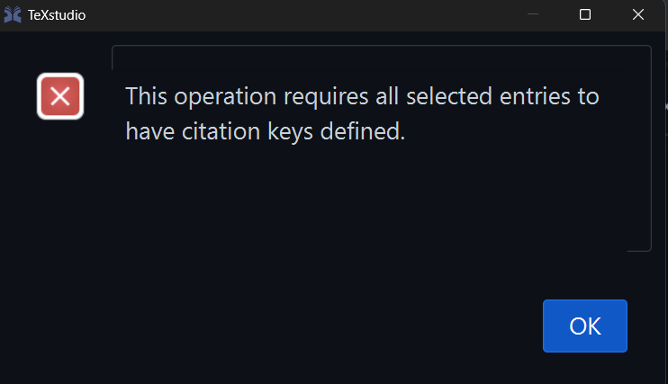

**Reset preferences**

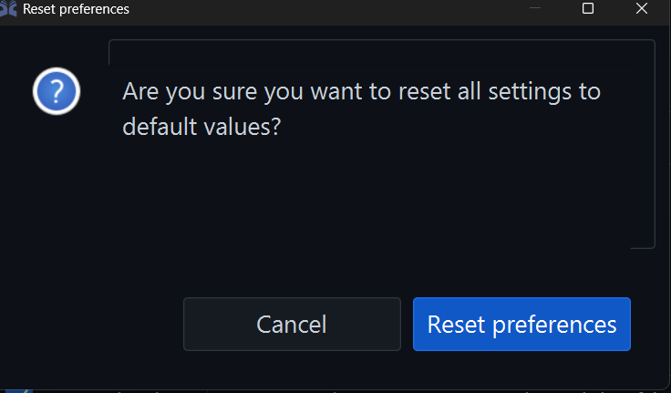

**Clear embeddings cache**

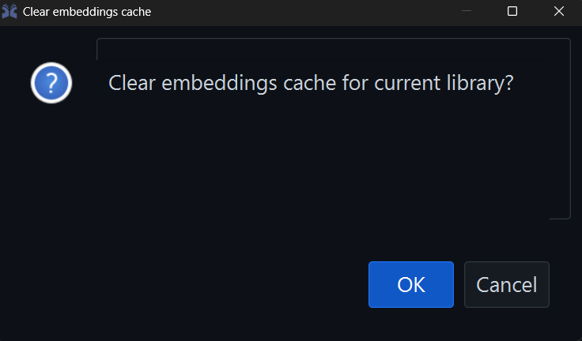

**Rebuild fulltext search index**

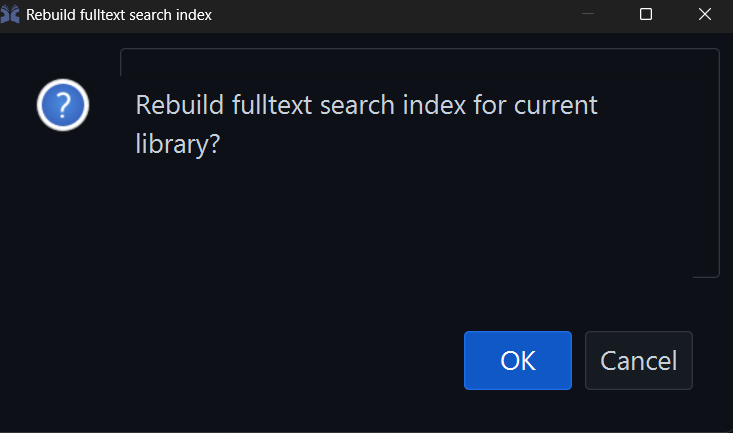

**Redownload missing files**

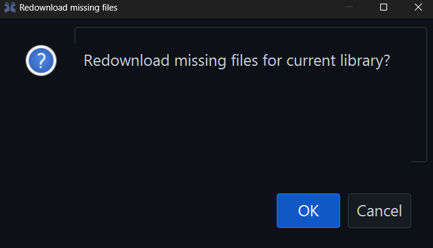

**Automatically set file links**

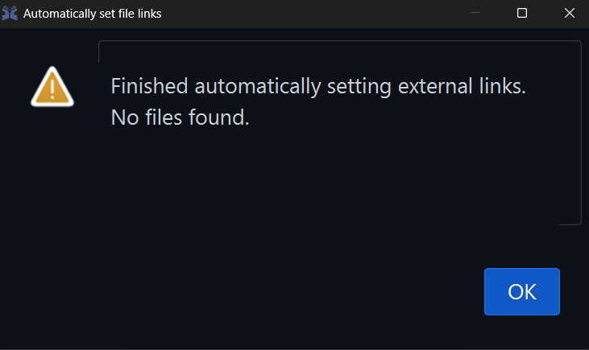

### Add Group

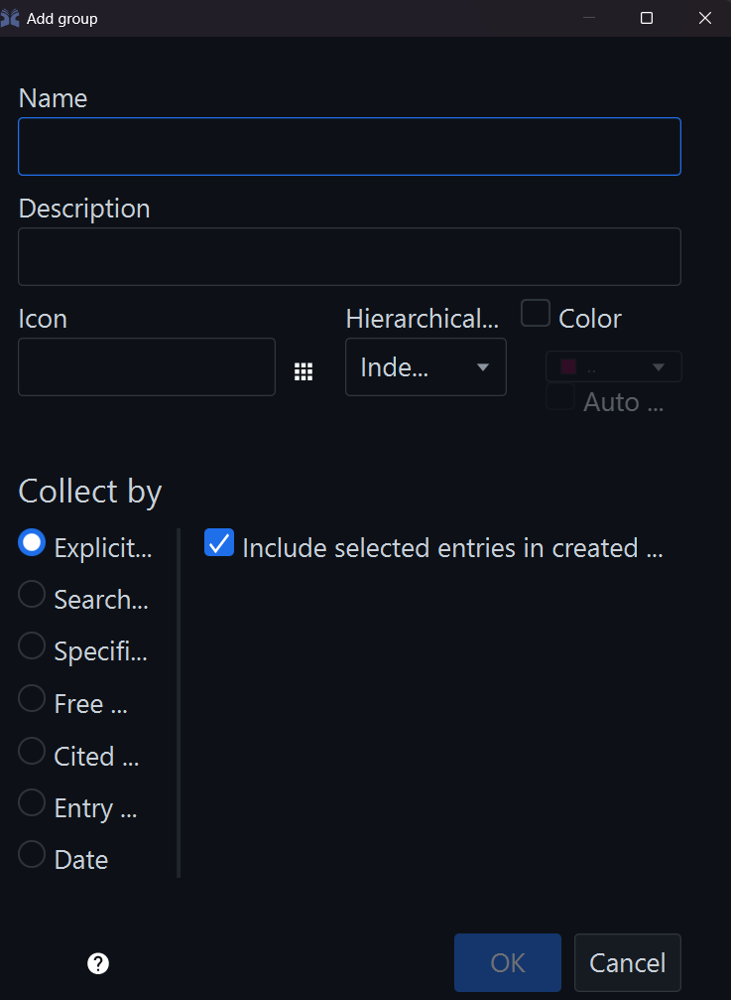

### Add New File Types

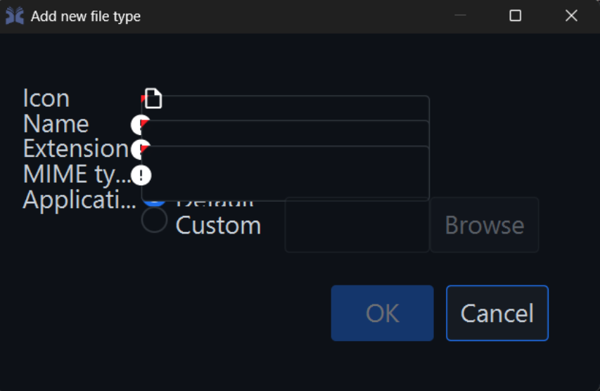

### Clean-up Entries

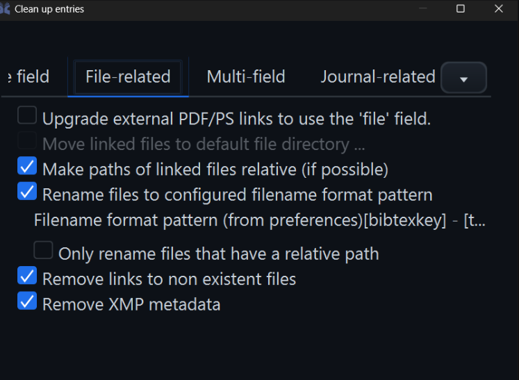

### Event Log

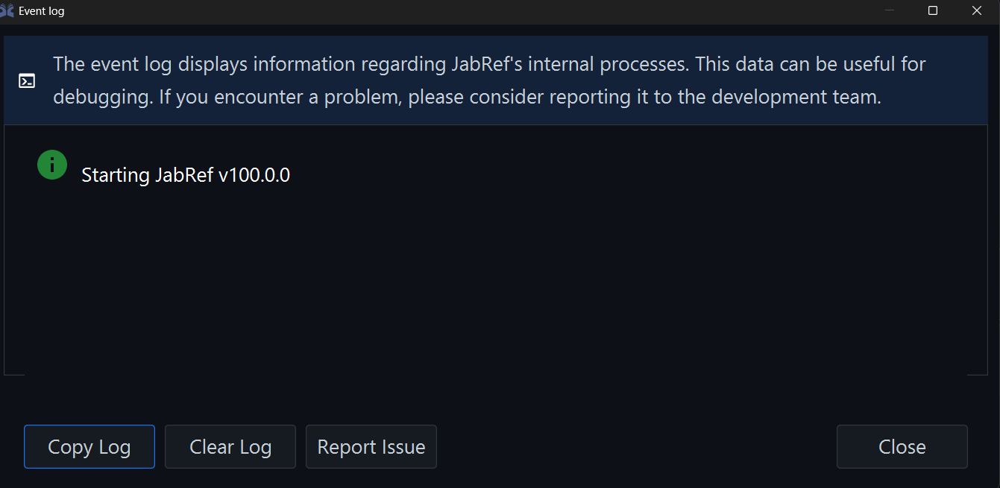

### Parse LaTeX Files

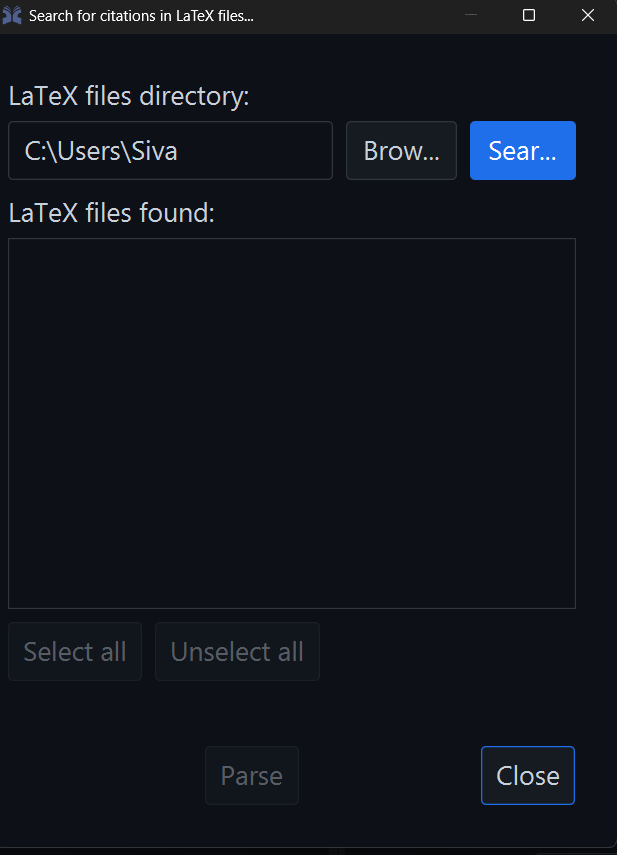

### Library Properties — Citation Key Patterns

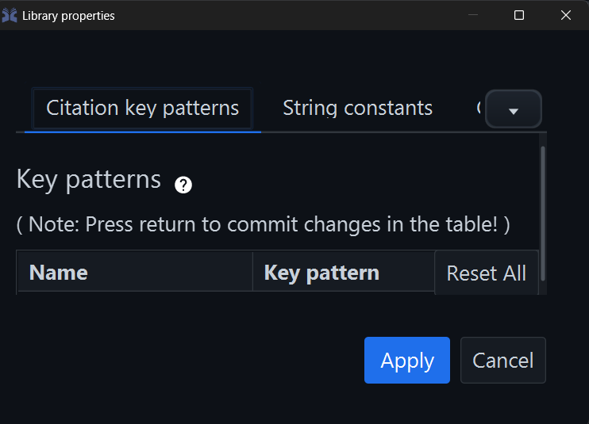

### Library Properties — Content Selectors

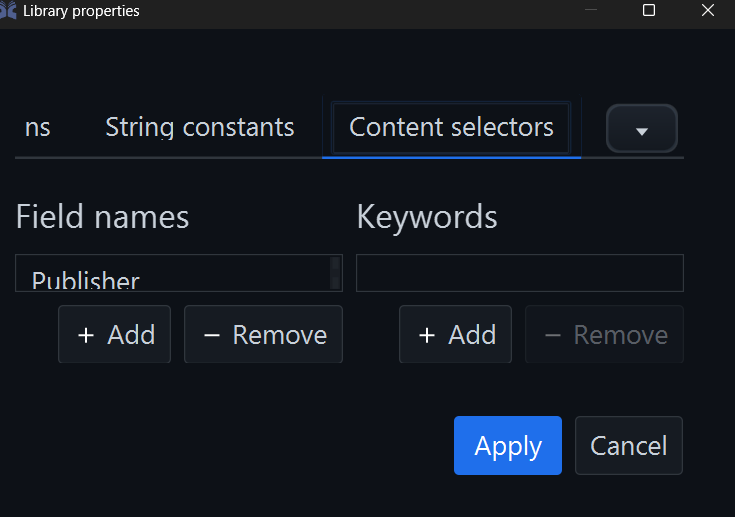

### Replace String

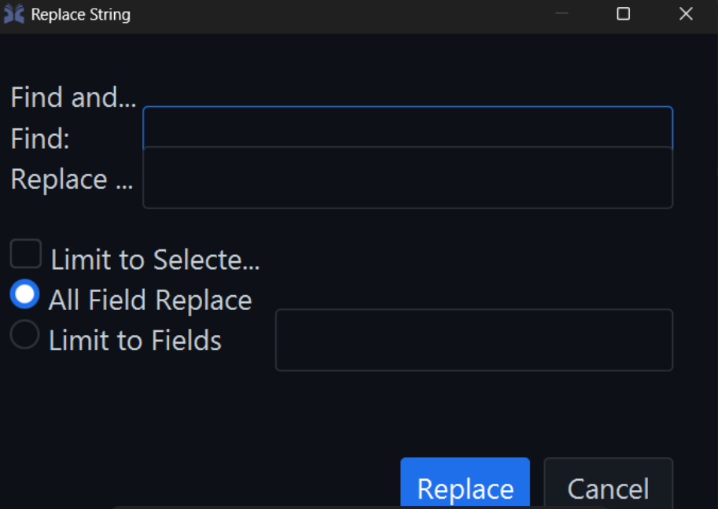

### Jump to Field

### Preferences

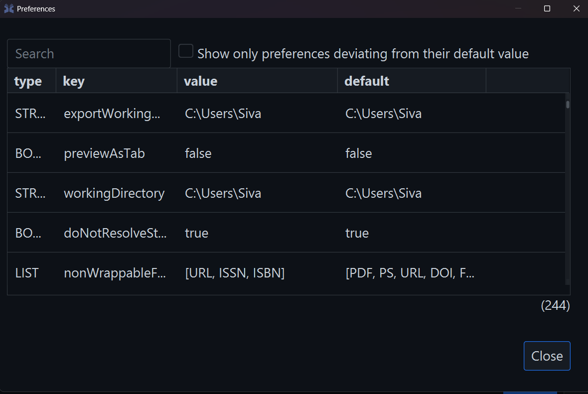

### Shared Database Login

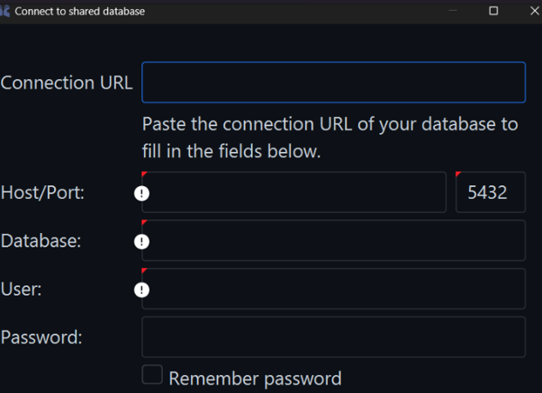
